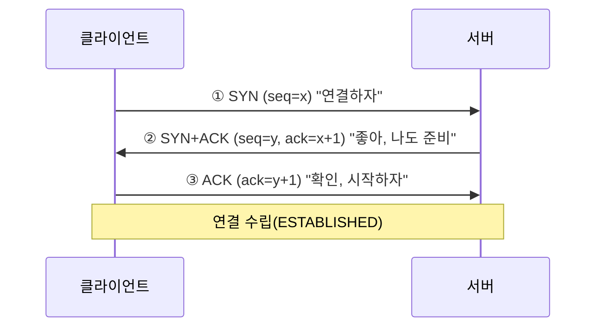
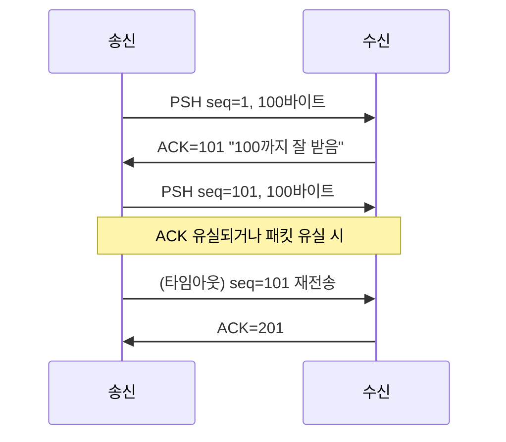
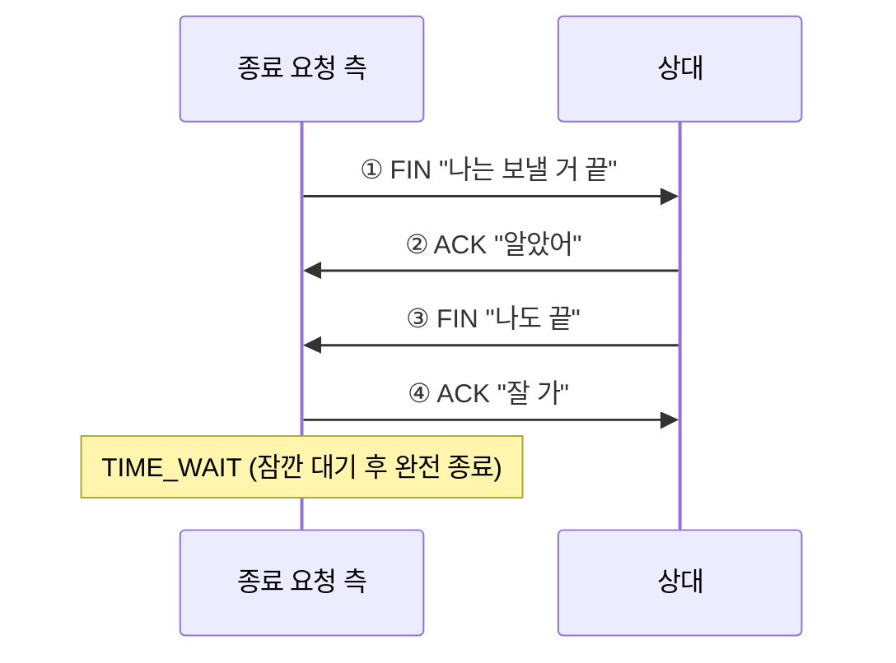

# TCP — 신뢰성 있는 연결 지향 프로토콜

> 최종 업데이트: 2026-06-17 | RFC 9293(2022, 구 RFC 793) 기준

## 개념

**TCP(Transmission Control Protocol)** 는 **데이터를 순서대로, 빠짐없이, 정확히 전달하는 것을 보장**하는 전송 계층(L4) 프로토콜이다. 인터넷에서 "한 바이트도 잃으면 안 되는" 통신 — 웹(HTTP), 메일(SMTP), 문자 발송(SMPP) 등 — 은 거의 다 TCP 위에서 돈다.

> 비유: 받는 사람 확인이 필요한 **등기우편**이다. 보낼 때마다 "받았다는 수령증(ACK)"을 돌려받고, 수령증이 안 오면 다시 보낸다. 여러 통을 보내도 **번호를 매겨(시퀀스) 순서대로** 정리되며, 중간에 분실되면 그 통만 재발송한다. 반대편 [UDP](#tcp-vs-udp)는 수령증 없이 그냥 던지는 일반우편이다.

핵심은 TCP가 **연결을 먼저 맺고(connection-oriented)**, 그 연결 위에서 **신뢰성**을 책임진다는 점이다. 그동안 [tcpdump](../../../Linux/네트워크/tcpdump.md)에서 본 `[S]`, `[P.]`, `[R.]` 같은 플래그가 전부 이 연결을 관리하는 TCP의 신호다.

## 배경/역사

| 시기 | 내용 |
|------|------|
| 1974 | **Vint Cerf**와 **Bob Kahn**이 TCP 개념 논문 발표 ("A Protocol for Packet Network Intercommunication") |
| 1981 | **RFC 793** 으로 표준화. TCP의 기본 명세 확정 |
| 1981~ | IP에서 분리 — TCP(신뢰성) + IP(주소·라우팅)로 역할 분담 → **TCP/IP** ([TCP-IP-Model](../네트워크-모델/TCP-IP-Model.md)) |
| 1988~ | Van Jacobson이 **혼잡 제어**(느린 시작 등) 도입 — 인터넷 붕괴(congestion collapse)를 막음 |
| 2022 | **RFC 9293** 으로 통합·갱신 (793 등 여러 RFC를 대체) |

TCP는 IP와 한 몸처럼 쓰여 **TCP/IP**라 불린다. IP는 "어디로 보낼지(주소·경로)"만 책임지고 도착·순서를 보장하지 않는데, 그 위에서 **TCP가 신뢰성을 얹어** 완성한다.

## TCP가 보장하는 네 가지

TCP의 정체성은 "무엇을 보장하느냐"에 있다.

| 보장 | 내용 | 수단 |
|------|------|------|
| **신뢰성** | 데이터가 반드시 도착 (유실 시 재전송) | ACK + 재전송 |
| **순서** | 보낸 순서대로 재조립 | 시퀀스 번호 |
| **흐름 제어** | 받는 쪽이 감당할 속도로 조절 | 수신 윈도우(rwnd) |
| **혼잡 제어** | 네트워크가 막히면 속도 양보 | 혼잡 윈도우(cwnd) |

> TCP는 데이터를 "메시지 덩어리"가 아니라 **연속된 바이트 스트림**으로 다룬다. 그래서 보낸 쪽이 한 번에 보낸 게 받는 쪽에서 쪼개져 오거나 합쳐져 올 수 있다(이를 경계가 없다 해서 **스트림**이라 한다).

### TCP vs UDP

| 구분 | TCP | UDP |
|------|-----|-----|
| 연결 | 연결 지향(handshake 먼저) | 비연결(바로 던짐) |
| 신뢰성 | 보장(재전송) | 없음(유실돼도 모름) |
| 순서 | 보장 | 없음 |
| 속도 | 상대적으로 느림(오버헤드) | 빠름 |
| 용도 | 웹·메일·문자발송·파일 | 영상 스트리밍·DNS·게임 |

## TCP 헤더의 제어 플래그

TCP는 모든 패킷(세그먼트) 앞에 헤더를 붙이고, 그 안의 **제어 플래그(1비트 스위치)** 로 의도를 전달한다. tcpdump에서 보던 그 신호들이다.

| 플래그 | 이름 | 역할 |
|--------|------|------|
| **SYN** | Synchronize | 연결 시작 (시퀀스 번호 동기화) |
| **ACK** | Acknowledgment | 데이터 수신 확인 |
| **PSH** | Push | 버퍼링 말고 즉시 앱에 전달 (실데이터 동반) |
| **FIN** | Finish | 정상 종료 요청 |
| **RST** | Reset | 비정상 강제 종료 |
| URG | Urgent | 긴급 데이터 (현재 거의 미사용) |

### tcpdump 표기 — 점(`.`)이 ACK

[tcpdump](../../../Linux/네트워크/tcpdump.md)는 이 플래그를 약자로 보여주며, **`.`은 ACK**를 뜻한다.

| 표기 | 실제 | 의미 |
|------|------|------|
| `[S]` | SYN | 연결 요청 |
| `[S.]` | SYN+ACK | 연결 수락 |
| `[.]` | ACK | 빈 확인 |
| `[P.]` | PSH+ACK | 데이터 전달 |
| `[F.]` | FIN+ACK | 정상 종료 |
| `[R.]` | RST+ACK | 강제 끊김 |

## 연결의 생애주기

TCP 연결은 **맺기 → 주고받기 → 끊기**의 정해진 절차를 따른다.

### ① 연결 맺기 — 3-way handshake

연결을 시작할 때 **세 번의 패킷**을 주고받아 양쪽이 서로 준비됐음을 확인한다.

> 비유: 전화 통화 시작. "여보세요?"(SYN) → "네 들려요, 그쪽은요?"(SYN+ACK) → "네 잘 들려요"(ACK). 서로 들리는 걸 확인해야 대화를 시작한다.

- 양쪽이 각자의 **시작 시퀀스 번호**(x, y)를 교환해 이후 바이트 순서의 기준점을 맞춘다
- 이 3단계가 끝나야 비로소 데이터를 보낼 수 있다 → **연결 설정 비용**(첫 통신에 1 RTT 추가)

### ② 데이터 주고받기 — 시퀀스와 ACK

- **시퀀스 번호(Seq)**: 보낸 바이트마다 번호를 매겨 수신측이 순서대로 재조립
- **ACK 번호**: "여기까지 받았다"는 **누적 확인**. ACK=101이면 "100번까지 다 받았고 다음은 101"
- **재전송**: ACK가 일정 시간(RTO) 안에 안 오면 같은 데이터를 다시 보냄. 이것이 신뢰성의 핵심

#### Ack 번호 = "다음에 받을 번호" = Seq + Len

ACK 번호는 영수증이 아니라 **다음 주문서**로 읽으면 쉽다 — "여기까지 받았으니 **다음은 이 번호부터 주세요**"라는 뜻이다. 그래서 값은 **받은 데이터의 시작번호(Seq) + 길이(Len)** 가 된다.

> 비유: 책을 373번부터 108장(373~480) 받았으면 "481번부터 주세요"라고 외친다. 이 481이 ack 번호이고, `373 + 108 = 481`이다.

정상 구간에선 **"내가 보낸 Seq+Len = 상대가 답하는 Ack"** 가 사슬처럼 맞물린다. 이 사슬이 끊기는 지점이 곧 유실 지점이다.

| 보낸 패킷 | Seq + Len | 다음 번호 | 상대 Ack | 정상? |
|----------|-----------|----------|----------|-------|
| No30 | 49 + 108 | 157 | 157 | ✅ |
| No32 | 157 + 108 | 265 | 265 | ✅ |
| No34 | 265 + 108 | 373 | 373 | ✅ |
| No36 | 373 + 108 | **481** | (안 옴) | ❌ 유실 |

481은 지어낸 숫자가 아니라 `373 + 108`, **정상이면 무조건 와야 할 다음 번호**다. 그게 끝내 안 오면 상대가 373~480을 못 받은 것이다.

#### 예외 — SYN과 FIN은 Len=0이어도 1칸 먹는다

| 패킷 종류 | 다음 Ack |
|----------|----------|
| 일반 데이터 | Seq + Len |
| **SYN / FIN** | Seq + **1** (Len 0이어도) |

SYN·FIN은 데이터가 없어도 **번호 한 칸**을 차지한다. 그래서 3-way handshake에서 SYN(Seq=0)을 받은 쪽이 `Ack=1`을 찍는 것이다 (`0 + 1`).

> 비유: 전화의 **"여보세요"** 는 내용은 없지만 한 마디로 친다. SYN/FIN이 그 "여보세요"다 — 데이터는 0인데 번호는 한 칸 먹는다. 이 예외만 빼면 나머지는 전부 `Seq + Len = 다음 Ack` 그대로다.

### ③ 연결 끊기 — 4-way handshake

- 양방향 연결이라 **각 방향을 따로 닫아야** 해서 FIN이 두 번 오간다(그래서 4-way)
- **TIME_WAIT**: 먼저 끊은 쪽(능동 종료)은 잠시(보통 2×MSL) 대기한다. 뒤늦게 도착하는 패킷이 다음 연결을 오염시키지 않도록 하는 안전장치

> ⚠️ 백엔드 함정: 짧은 연결을 **대량으로** 맺고 끊으면 능동 종료 측에 TIME_WAIT 소켓이 수만 개 쌓여 **로컬 포트가 고갈**된다. 그래서 SMPP·DB 연동처럼 반복 통신은 연결을 **재사용(keep-alive·커넥션 풀)** 하는 게 정석이다.

### ✗ 비정상 종료 — RST

정상 절차(FIN)를 건너뛰고 **즉시 강제로 끊는** 신호가 RST다.

- 닫힌 포트로 패킷이 옴 / 이미 죽은 연결에 데이터가 옴 / 앱이 강제 close
- tcpdump에 `[R.]`이 **반복·대량**으로 보이면 연동 불안정 신호 → 직전 패킷과 앱 로그를 함께 봐야 한다

## ACK 깊이 읽기 — piggyback과 두 층위

실무 로그를 보면 순수 `[ACK]`보다 **`[PSH,ACK]`가 훨씬 많다.** 왜 그런지, 그리고 'ACK'라는 말이 왜 헷갈리는지를 정리한다. (검증 예시 패킷 — `No35 npro3 → BMS [PSH,ACK] Seq=251 Ack=373 Len=53`)

### `[PSH,ACK]` 한 줄에는 두 주체가 들어있다

이 한 줄은 **서로 다른 두 가지**가 합쳐진 것이다.

| 구성 | 필드 | 만든 주체 | 의미 |
| `[PSH]` + `Len=53` | 데이터 53바이트 | **앱** | 애플리케이션이 쓴 응답 메시지(예: BEGIN ACK) |
| `[ACK]` + `Ack=373` | ack 번호 | **커널** | "373 직전까지 받았다"는 수신 도장 |

→ 즉 **커널 ACK가 없는 게 아니라**, 그 `[PSH,ACK]` 라인 속에 `Ack=373`으로 **박혀 있는** 것이다.

여기서 'ACK'라는 단어가 두 번 나와 헷갈리는데, **둘은 완전히 다른 층위**다.

| 'ACK'로 불리는 것 | 정체 | 층위 |
| **BEGIN ACK** (데이터) | 앱이 만든 업무 응답. 이름에 ACK가 붙었을 뿐 | 애플리케이션 |
| **Ack=373** (헤더 필드) | TCP의 받음 확인 번호 | TCP(전송) |

### piggyback — ACK가 데이터에 업혀 간다

커널은 데이터를 받으면 ACK를 보내야 하는데, **마침 앱도 보낼 데이터가 있으면 둘을 한 패킷에 합쳐** 보낸다. 이것이 **piggyback(업혀가기)** 이다.

> 비유: 택배 기사가 **물건을 배달하러 가는 김에** "어제 보내주신 것 잘 받았습니다" 수령증도 같이 전한다. 수령증만 전하러 빈손으로 한 번 더 오지 않고, 가는 길에 묻어 봉투 하나를 아끼는 것.

| 상황 | 나가는 패킷 |
| 앱이 보낼 응답이 **있음** | 커널 ACK가 데이터에 업힘 → **`[PSH,ACK]` 한 줄** |
| 앱이 보낼 응답이 **없음** | 커널 ACK 단독 → **`[ACK]` Len=0** |

그래서 앱이 바로바로 응답하는 정상 구간엔 `[PSH,ACK]`만 보이고, 순수 `[ACK]`는 앱이 보낼 게 없을 때(인증 대기 등)만 드물게 나온다.

### ack 번호는 커널이 책임진다

핵심은 **ack 번호를 찍는 주체가 앱이 아니라 커널**이라는 점이다. 앱이 응답을 못/안 보내도 커널이 순수 `[ACK]`로라도 보낸다.

- 앱 응답 있음 → `[PSH,ACK]`에 업혀 감
- 앱 응답 없음 → 순수 `[ACK]`로 단독
- **어느 쪽이든 ack 번호는 무조건 나간다**

따라서 "상대가 받았나"를 검증할 땐 **패킷 형태(`[PSH,ACK]`냐 `[ACK]`냐)는 무시하고, ack 숫자가 기대값까지 올라왔는지만** 보면 된다.

### ACK가 안 와도 "무조건 못 받음"은 아니다

ack 번호가 안 보인다고 바로 유실로 단정하면 안 된다. **두 가지 가능성**이 있고 송신측은 이를 구분하지 못한다.

| 시나리오 | 실제 |
|---------|------|
| ① 진짜 못 받음 | 보낸 데이터가 가는 길에 유실 |
| ② **ACK만 유실** | 상대는 받아서 ACK를 보냈는데 **돌아오는 ACK가 유실** |

그래서 TCP는 일단 **재전송(RTO 초과 시 재송신)** 으로 메우고, 재전송까지 전부 실패해야 비로소 전달 실패로 판정한다. ack 번호가 **끝내** 기대값까지 안 올라올 때가 진짜 못 받은 것이다.

### TCP ACK가 와도 "앱이 처리한" 건 아니다

위 ack 번호(커널 도장)는 **데이터가 상대 커널까지 도착**했다는 것만 보장한다. 그 데이터를 상대 **애플리케이션이 읽고 처리했는지**는 보장하지 않는다 — 커널 버퍼에 쌓였을 뿐 앱이 안 읽었거나, 읽다 죽었을 수도 있다.

| 신호 | 보장하는 것 | 보장 못 하는 것 |
|------|-----------|----------------|
| **TCP ack 번호** | 상대 **커널**까지 도착 | 앱이 읽음·처리함 |
| **앱 레벨 응답** | 앱이 받아 **처리**함 | — |

그래서 "상대가 정말 처리했나"는 **애플리케이션 레벨 응답**으로 확인해야 한다. SMPP의 `submit_sm`(발송) → **`submit_sm_resp`(접수 응답)** 가 그 예이고, 위 로그의 **BEGIN ACK 데이터**도 바로 이 앱 레벨 응답이다. **TCP ack는 "네트워크가 배달함", 앱 응답은 "상대 앱이 접수함"** — 층위가 다르다.

## 신뢰성을 떠받치는 메커니즘

### 흐름 제어 (Flow Control) — 받는 쪽 배려

수신측이 처리 못 할 만큼 빨리 보내면 데이터가 버려진다. 그래서 수신측은 **"내 버퍼에 이만큼 여유 있다"(수신 윈도우, rwnd)** 를 매 ACK에 실어 알리고, 송신측은 그만큼만 보낸다.

> 비유: 물을 따라주는 사람이 컵 크기를 계속 알려주고, 따르는 사람은 넘치지 않게 그만큼만 붓는 것. 이 "한 번에 보낼 수 있는 양"을 슬라이딩하며 조절해 **슬라이딩 윈도우**라 한다.

### 혼잡 제어 (Congestion Control) — 네트워크 배려

흐름 제어가 *상대*를 배려하는 거라면, 혼잡 제어는 *네트워크 전체*를 배려한다. 길이 막히면 속도를 줄인다.

- **느린 시작(Slow Start)**: 처음엔 조금씩 보내다 점점 늘림 (혼잡 윈도우 cwnd를 키움)
- **혼잡 회피·AIMD**: 유실(혼잡 신호)이 감지되면 전송량을 확 줄이고, 괜찮으면 천천히 늘림
- 1980년대 인터넷이 혼잡으로 마비된 뒤 Van Jacobson이 도입해, 모두가 양보하며 공존하게 만든 장치다

## 백엔드에서 TCP를 다룰 때

- **소켓**: 애플리케이션은 TCP를 직접 다루지 않고 **소켓** API(`socket`/`bind`/`listen`/`accept`/`connect`)로 쓴다 ([port-vs-socket](../port-vs-socket.md))
- **연결 재사용**: TIME_WAIT·handshake 비용 때문에, 반복 통신은 **커넥션 풀**이나 keep-alive로 연결을 살려 쓴다 (SMPP의 영속 세션, HTTP keep-alive, DB 풀)
- **Nagle 알고리즘**: 작은 데이터를 모아 보내 효율을 높이지만 지연이 생길 수 있어, 실시간성이 중요하면 `TCP_NODELAY`로 끈다 (PSH로 즉시 보내려는 맥락)
- **상태 확인**: `ss -tn`(연결 상태), `ss -tnlp`(리슨 포트), tcpdump(패킷 레벨)로 진단

## 정리

- **TCP** = 연결을 먼저 맺고 **신뢰성·순서·흐름·혼잡**을 보장하는 전송 계층 프로토콜
- IP(주소·경로) 위에 신뢰성을 얹어 **TCP/IP**를 완성
- **제어 플래그**(SYN·ACK·PSH·FIN·RST)로 연결을 관리 — tcpdump에서 보던 그 신호들
- 생애주기: **3-way handshake(맺기) → seq/ACK(주고받기) → 4-way(끊기)**, `RST`은 비정상
- 신뢰성 = **ACK + 재전송**, 안정성 = **흐름 제어(rwnd) + 혼잡 제어(cwnd)**
- 백엔드 핵심: **TIME_WAIT·연결 재사용(풀)·소켓**

## 관련 문서

- [tcpdump](../../../Linux/네트워크/tcpdump.md) — TCP 플래그·핸드셰이크를 패킷으로 직접 관찰
- [IP](IP.md) — TCP가 그 위에 신뢰성을 얹는 네트워크 계층 프로토콜 (TCP/IP)
- [TCP-IP-Model](../네트워크-모델/TCP-IP-Model.md) — TCP가 속한 4계층 모델
- [port-vs-socket](../port-vs-socket.md) — TCP 연결을 식별하는 포트·소켓
- [SMTP](SMTP.md) / [gRPC](gRPC.md) — TCP 위에서 동작하는 상위 프로토콜
- [SMS 기술 규격](../이동통신/SMS-기술규격.md) — SMPP가 TCP 세션 위에서 문자를 발송하는 구조

## 출처

- [RFC 9293 — Transmission Control Protocol (2022)](https://www.rfc-editor.org/rfc/rfc9293)
- Cerf, Kahn, "A Protocol for Packet Network Intercommunication" (1974)
