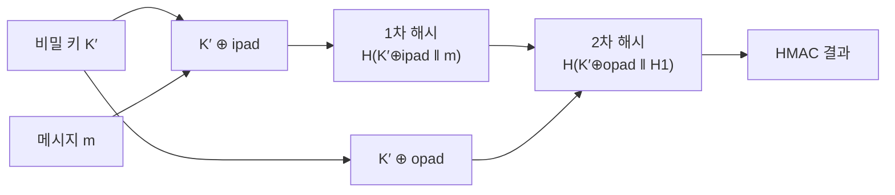

# HMAC (Hash-based Message Authentication Code)

> 최종 업데이트: 2026-08-21 | 보안 관점

## 개념

HMAC은 **비밀 키(secret key) + 메시지를 정해진 규칙으로 섞어, 그 키를 모르는 사람은 절대 같은 결과를 만들 수 없게 만든 값**이다. 그냥 해시(SHA-256 단독)는 누구나 같은 입력에 같은 출력을 계산할 수 있어 **"이 값이 맞다"(무결성)** 만 확인 가능하지만, HMAC은 **"이걸 만든 사람이 비밀 키를 알고 있었다"(인증)** 까지 증명한다.

> 우체국 등기와 일반 편지의 차이와 같다. **일반 편지**(그냥 해시)는 내용이 도착 시 그대로인지만 확인할 수 있다. **등기**(HMAC)는 발송인이 **정해진 도장(비밀 키)**을 가지고 있었다는 것까지 증명한다 — 도장이 없으면 아무리 내용을 똑같이 써도 등기 소인을 위조할 수 없다.

## 배경/역사

**Mihir Bellare, Ran Canetti, Hugo Krawczyk**가 1996년 CRYPTO '96 논문 *"Keying Hash Functions for Message Authentication"*에서 HMAC(과 그 이론적 토대인 NMAC)을 처음 제안했다. 1997년 **RFC 2104**로 표준화됐고, 2008년 **FIPS 198-1**로 미국 연방표준(NIST)에도 채택됐다. 현재 IPsec·SSH·TLS·JWT 등 인터넷 보안 프로토콜 전반의 기반 요소다.

## 왜 그냥 `H(key + message)`로는 안 되는가

직관적으로는 "키랑 메시지를 이어붙여 해싱하면 되지 않나?" 싶지만, 이 단순한 방식은 뚫린다.

- **`H(key ‖ message)`** — SHA-256 같은 **Merkle–Damgård 구조** 해시 함수는 **길이 확장 공격(length extension attack)**에 취약하다. 공격자가 키를 몰라도, 기존 해시값만으로 **`H(key ‖ message ‖ padding ‖ 추가데이터)`**를 계산해 **유효한 새 MAC을 위조**할 수 있다.
- **`H(message ‖ key)`** — 이 순서는 길이 확장엔 안 걸리지만, 해시 **충돌(collision)**을 찾으면 곧바로 MAC 충돌로 이어진다.

두 방식 모두 "그냥 이어붙이기"의 구조적 약점을 갖는다. HMAC은 **이중 해싱(nested hashing)**으로 이 문제 자체를 없앤다.

## 구조 — 이중 해싱(Nested Hashing)

```
HMAC(K, m) = H( (K′ ⊕ opad) ‖ H( (K′ ⊕ ipad) ‖ m ) )
```



| 요소 | 의미 |
|------|------|
| `K′` | 키를 해시 블록 크기에 맞춘 것(짧으면 0으로 패딩, 길면 먼저 해시) |
| `ipad` | 블록 크기만큼 반복된 고정 상수 `0x36` |
| `opad` | 블록 크기만큼 반복된 고정 상수 `0x5c` |
| **1차 해시** | 메시지를 안쪽 키로 감싸 해싱 — 결과는 **키를 모르면 재현 불가** |
| **2차 해시** | 1차 결과를 바깥쪽 키로 **다시 한번** 감싸 해싱 |

**핵심은 2차 해시다.** 공격자가 1차 해시 결과를 안다고 해도, **바깥쪽 키(`K′⊕opad`)를 모르면 2차 해시를 이어붙여 확장할 수 없다** — 안쪽 결과가 다시 통째로 새 키에 감싸이기 때문에, 길이 확장 공격이 파고들 틈(마지막 블록 상태만 알면 되는 성질)이 사라진다.

## MAC vs 그냥 해시 vs 디지털 서명

셋 다 "변조 여부"를 검증하지만, **증명하는 범위**가 다르다.

| | 그냥 해시 | **HMAC (MAC)** | 디지털 서명 |
|---|-----------|----------------|--------------|
| 키 | 없음 | **대칭** — 발신·수신이 **같은 비밀 키 공유** | **비대칭** — 개인키로 서명, 공개키로 검증 |
| 증명 범위 | 무결성만 | 무결성 + **인증**(그 키를 가진 자가 만듦) | 무결성 + 인증 + **부인방지**(서명자만 서명 가능) |
| 검증자 | 누구나 | **키를 공유한 쪽만** | **누구나**(공개키로) |
| 예 | SHA-256 체크섬 | HMAC-SHA256 | RSA·ECDSA 서명 |

HMAC은 **양쪽이 같은 키를 갖고 있어야** 검증되므로, "발신자가 만들었다"는 것까지는 증명해도 **"수신자가 아니라 발신자가 만들었다"는 부인방지는 안 된다** — 수신자도 같은 키로 똑같은 MAC을 만들 수 있기 때문이다. 이 지점이 비대칭키 기반 **디지털 서명**과의 근본적 차이다.

## 실전에서 쓰이는 곳

| 용도 | 동작 |
|------|------|
| **JWT `HS256`** | 헤더+내용을 HMAC-SHA256으로 서명, 검증도 같은 비밀 키로 재계산해 비교 (→ [JWT 개념](../../Spring/스프링-시큐리티/JWT-개념.md)) |
| **Webhook 서명 검증** | GitHub·Stripe 등이 payload의 HMAC을 헤더(`X-Hub-Signature` 등)에 실어 보냄. 수신 서버가 같은 시크릿으로 재계산해 값이 같으면 "진짜 발신처가 맞다"고 판단 |
| **AWS SigV4** | API 요청 서명에 HMAC-SHA256 체인 사용 |
| **TLS Finished 메시지** | 지금까지 주고받은 핸드셰이크 메시지 전체의 HMAC으로 변조 여부 확인 (→ [TLS Handshake](../네트워크/보안/TLS/TLS-Handshake.md)) |
| **비밀번호 페퍼(pepper)** | 저장 전 `HMAC(pepper, password)`로 감싸 DB 유출 시 추가 방어벽을 둠 (→ [비밀번호 해싱](비밀번호-해싱.md)) |

## 검증 시 주의 — 상수 시간 비교

수신한 MAC과 재계산한 MAC을 **일반 `==`나 문자열 비교**로 검사하면, 비교가 **틀린 바이트에서 즉시 멈추는 시간차**를 공격자가 측정해 값을 한 바이트씩 추측하는 **타이밍 공격**에 노출된다. 그래서 검증은 **상수 시간(constant-time) 비교**로 한다.

```java
Mac mac = Mac.getInstance("HmacSHA256");
mac.init(new SecretKeySpec(secretKey, "HmacSHA256"));
byte[] computed = mac.doFinal(message.getBytes(StandardCharsets.UTF_8));

// 상수 시간 비교 — 바이트 불일치 위치와 무관하게 항상 같은 시간
boolean valid = MessageDigest.isEqual(expectedMac, computed);
```

## 정리

> **HMAC = 비밀 키와 메시지를 이중 해싱 구조로 감싸, 그 키를 모르면 절대 같은 값을 만들 수 없게 한 인증코드.** 그냥 해시는 무결성만 증명하지만, HMAC은 "그 키를 가진 자가 만들었다"는 인증까지 증명한다. `H(key‖message)` 한 겹으로는 길이 확장 공격에 뚫리므로, **`ipad`/`opad`로 안쪽·바깥쪽 키를 다르게 써 두 번 해싱**한다. 대칭키 기반이라 부인방지는 안 되며, 이 점에서 비대칭키 기반 디지털 서명과 구분된다. JWT `HS256`, Webhook 서명, AWS SigV4, TLS Finished 메시지가 모두 HMAC을 쓴다.

## 관련 문서

- [SHA-256](SHA-256.md) — HMAC이 감싸는 내부 해시 함수, 길이 확장 공격의 원인
- [비밀번호 해싱](비밀번호-해싱.md) — 페퍼를 HMAC으로 적용하는 방식
- [JWT 개념](../../Spring/스프링-시큐리티/JWT-개념.md) — `HS256` 서명에 HMAC 사용
- [TLS Handshake](../네트워크/보안/TLS/TLS-Handshake.md) — Finished 메시지의 HMAC
- [checksum](../../Linux/파일/checksum.md) — 무결성만 증명하는 일반 해시와의 대비
- [OWASP Top 10](OWASP-Top-10.md) — A02 Cryptographic Failures 관점

## 출처

- [RFC 2104 — HMAC: Keyed-Hashing for Message Authentication](https://www.rfc-editor.org/rfc/rfc2104)
- [FIPS 198-1 — The Keyed-Hash Message Authentication Code](https://csrc.nist.gov/pubs/fips/198-1/final)
- Bellare, Canetti, Krawczyk, *"Keying Hash Functions for Message Authentication"*, CRYPTO '96
