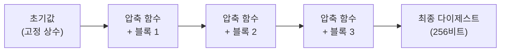

# SHA-256 (Secure Hash Algorithm 256-bit)

> 최종 업데이트: 2026-08-21 | 보안 관점

## 개념

SHA-256은 **어떤 길이의 입력이든 항상 256비트(32바이트, 16진수 64자리)의 고정된 지문으로 압축하는 암호학적 해시 함수**다. 입력이 1바이트 바뀌어도 출력은 완전히 딴 값이 되고, 같은 입력은 언제나 같은 출력을 낸다.

> 문서 파쇄기와 같다. 어떤 문서(1장이든 1000장이든)를 넣어도 **항상 같은 크기의 종이 조각 뭉치(256비트)**가 나온다. 조각만 보고 원문을 복원할 수 없고(단방향), 원문에 쉼표 하나만 바꿔 넣어도 조각의 모양은 완전히 달라진다.

## 배경/역사

**NSA(미국 국가안보국)**가 설계했고 **2001년** 처음 발표됐다. **NIST**가 **FIPS PUB 180-2**(2002년, 이후 2008·2012년 개정을 거쳐 현재 **FIPS 180-4**)로 표준화한 **SHA-2 계열**의 대표 함수다. 전신인 **SHA-1**(1995)이 이론·실증 공격(2017년 Google "SHAttered")으로 무너지면서 그 대체재로 자리잡았다. 이후 등장한 **SHA-3**(2015, Keccak 기반)은 SHA-2와 **설계 계보가 다른 별개 알고리즘**이며, SHA-256을 대체하기 위한 것이 아니라 **보험용 대안**으로 병행 표준화됐다.

## 세 가지 핵심 성질

암호학적 해시가 이름값을 하려면 아래 셋을 모두 만족해야 한다.

| 성질 | 의미 | 깨지면 생기는 문제 |
|------|------|---------------------|
| **단방향성(one-way)** | 출력에서 입력을 역산 불가 | 해시만 보고 원문 복원 가능 → 비밀번호 등 무력화 |
| **결정성 + 고정 길이** | 같은 입력 → 항상 같은 256비트 출력 | 검증(비교) 자체가 불가능해짐 |
| **충돌 저항성(collision resistance)** | 다른 입력 두 개가 같은 출력을 내기가 사실상 불가능 | 위조 문서가 원본과 같은 해시를 가짐 → 무결성 검증 무력화 |

SHA-256은 현재까지 이 세 성질을 **전부 만족**하는 검증된 표준이다. (MD5·SHA-1은 세 번째, 충돌 저항성이 실증 공격으로 깨졌다 → [checksum](../../Linux/파일/checksum.md))

## 내부 구조 — Merkle–Damgård

SHA-256은 입력을 **512비트(64바이트)씩 블록으로 잘라, 앞 블록의 결과를 다음 블록 계산에 이어 넣는(체이닝)** 방식으로 동작한다. 이를 **Merkle–Damgård 구조**라 부른다.



| 구성 | 값 |
|------|-----|
| 블록 크기 | 512비트 |
| 라운드 수 | 64라운드(블록당) |
| 내부 압축 함수 | Davies–Meyer 구조(전용 블록 암호 기반) |
| 출력 크기 | 256비트(고정) |
| 패딩 | 입력 끝에 `1` 비트 + `0` 채움 + **원본 길이(64비트)**를 붙여 512비트 배수로 맞춤 |

**패딩에 원본 길이가 박혀 있다는 점이 중요하다** — 이게 뒤에 나올 **길이 확장 공격**의 핵심 재료다. 마지막 블록의 중간 상태(체이닝 값)만 알면, **원문 전체를 몰라도** 그 뒤에 새 블록을 이어 붙여 **"원문 + 추가데이터"에 대한 유효한 해시**를 계산할 수 있다. 이 약점 때문에 **키를 섞어 인증까지 하려면 SHA-256을 그냥 이어붙이는 게 아니라 HMAC처럼 감싸야** 한다. (→ [HMAC](HMAC.md))

## 어디서 쓰이나

| 용도 | 쓰임 |
|------|------|
| **무결성 검증** | 파일 체크섬(`sha256sum`), 다운로드 배포본 변조 확인 (→ [checksum](../../Linux/파일/checksum.md)) |
| **버전 관리** | Git의 최신 오브젝트 해시(SHA-1에서 전환 진행 중) |
| **블록체인** | 비트코인의 블록 해시·머클 트리(더블 SHA-256) |
| **TLS/인증서** | 인증서 서명 알고리즘의 해시 부분(`SHA256withRSA` 등) |
| **인증 코드의 재료** | HMAC-SHA256, JWT `HS256`의 내부 해시 함수 (→ [JWT 개념](../../Spring/스프링-시큐리티/JWT-개념.md)) |

## 왜 비밀번호 저장에는 그대로 쓰면 안 되나

세 가지 성질을 다 만족하는 SHA-256도 비밀번호 저장에는 **부적합**하다. 이유는 안전성이 아니라 **속도**다 — SHA-256은 초당 수억 번을 계산할 만큼 **빠르게 설계**됐다(무결성 검증은 빨라야 좋으니까). 그런데 비밀번호는 **느려야 안전**하다 — 느려야 공격자의 무차별 대입(브루트포스)이 비싸진다.

그래서 비밀번호는 SHA-256이 아니라 **일부러 느리게 설계된 bcrypt·scrypt·Argon2id**를 쓴다. 자세한 이유와 솔트·페퍼 구조는 → [비밀번호 해싱](비밀번호-해싱.md).

## SHA 계열 비교

| | MD5 | SHA-1 | **SHA-256(SHA-2)** | SHA-3 |
|---|-----|-------|---------------------|-------|
| 출력 | 128비트 | 160비트 | **256비트** | 256비트(가변 가능) |
| 발표 | 1991 | 1995 | **2001** | 2015 |
| 구조 | Merkle–Damgård | Merkle–Damgård | **Merkle–Damgård** | Sponge(Keccak) — 계보 다름 |
| 상태 | ❌ 충돌 실증(2004) | ❌ 충돌 실증(2017 SHAttered) | ✅ **현재 표준, 안전** | ✅ 안전(보험용 대안) |

## Java 코드 예시

```java
MessageDigest digest = MessageDigest.getInstance("SHA-256");
byte[] hash = digest.digest(input.getBytes(StandardCharsets.UTF_8));
String hex = HexFormat.of().formatHex(hash);   // 16진수 64자리 문자열
```

## 정리

> **SHA-256 = 어떤 입력이든 256비트 고정 지문으로 압축하는 단방향 암호학적 해시 함수.** NSA가 설계해 2001년 발표, FIPS 180-4로 표준화됐고 SHA-1의 충돌 취약점을 대체하는 SHA-2 계열의 대표주자다. 512비트 블록을 체이닝하는 Merkle–Damgård 구조라, **패딩에 원본 길이가 남아 길이 확장 공격의 여지가 있다** — 그래서 키 기반 인증에는 맨 해시가 아니라 HMAC처럼 감싸 써야 한다. 무결성 검증엔 최적이지만, 너무 빨라서 비밀번호 저장에는 부적합하다.

## 관련 문서

- [HMAC](HMAC.md) — SHA-256을 키와 함께 안전하게 쓰는 방법(길이 확장 공격 방어)
- [비밀번호 해싱](비밀번호-해싱.md) — SHA-256이 비밀번호 저장에 부적합한 이유와 대안
- [checksum](../../Linux/파일/checksum.md) — `sha256sum`을 이용한 파일 무결성 검증 실무
- [해싱 — 해시 테이블](../알고리즘/Hashing.md) — 자료구조용 해시(비암호)와의 구분
- [OWASP Top 10](OWASP-Top-10.md) — A02 Cryptographic Failures 관점

## 출처

- [NIST FIPS 180-4 — Secure Hash Standard (SHS)](https://csrc.nist.gov/pubs/fips/180-4/final)
- [SHA-1 gets SHAttered — Evervault](https://evervault.com/blog/sha-1-gets-shattered)
