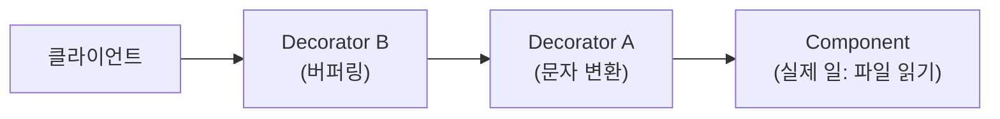

# 데코레이터 패턴 (Decorator Pattern)

> 최종 업데이트: 2026-08-05 | GoF 구조 패턴

## 개념

데코레이터 패턴은 **같은 인터페이스를 유지한 채 객체를 겹겹이 감싸, 겹마다 기능 하나를 덧붙이는** 구조 패턴이다. 상속이 아니라 **조합(composition)**으로 기능을 확장한다.

> 선물 포장과 같다. 물건(핵심 기능)을 포장지로 싸고, 리본을 얹고, 다시 쇼핑백에 넣는다. **겉에서 보면 여전히 "받을 수 있는 물건"**(같은 인터페이스)이지만 겹마다 기능이 하나 더해진다.

성립 조건은 두 가지다.

| 조건 | 의미 |
|------|------|
| **감싸는 놈과 감싸이는 놈이 같은 타입** | 클라이언트는 몇 겹인지 몰라도 그대로 쓴다 |
| **생성자로 대상(delegate)을 받음** | `new Wrapper(target)` — 감쌀 대상을 주입 |

## 왜 상속이 아니라 감싸기인가

기능 조합을 상속으로 하면 **클래스가 조합마다 필요해 폭발**한다.

```
BufferedFileReader, GzipFileReader, BufferedGzipFileReader,
EncryptedBufferedGzipFileReader ...     ← 조합 폭발
```

데코레이터는 **런타임에 필요한 겹만 골라 조립**해 이를 없앤다.

```java
new BufferedReader(new InputStreamReader(new GZIPInputStream(in)))
```

## 구조



- 호출은 **겉에서 안쪽으로 위임**되다가 실제 일을 하는 **Component**에 닿는다.
- 결과가 되돌아 나오며 **각 겹이 자기 몫을 가공**한다.

## 대표 예 — Java I/O

자바 표준 입출력이 데코레이터의 교과서다.

```java
new BufferedReader(new InputStreamReader(new FileInputStream("a.txt")))
//   버퍼링 겹        문자 변환 겹          파일 읽기(실제 일)
```

| 층 | 역할(관심사) |
|----|-------------|
| `FileInputStream` | **Component** — 바이트 읽기 |
| `InputStreamReader` | 데코레이터 — 바이트 → 문자 변환 |
| `BufferedReader` | 데코레이터 — 버퍼링 |

파일 읽기 하나에 이미 3겹이 쓰인다. 모두 `Reader`/`InputStream` 계열이라 **타입은 그대로**다.

## 실전 예 — Kafka Deserializer

Spring Kafka는 아예 **감싸라고 만들어 둔 클래스**를 제공한다. `ErrorHandlingDeserializer`(EHD)의 생성자가 delegate를 받는 것이 그 증거다.

```
EHD( JsonDeserializer )                        ← 가장 흔한 2겹 (Spring 권장 조합)
EHD( RetryingDeserializer( AvroDeserializer )) ← 3겹. Avro + Schema Registry의 정석
DelegatingByTopicDeserializer( 토픽별 파서들 )  ← 라우팅 겹
```

3겹 예시의 관심사 분해를 보면 패턴의 이점이 드러난다.

| 겹 | 관심사 |
|----|--------|
| `ErrorHandlingDeserializer` | 진짜 실패를 **흡수**(예외를 삼켜 컨슈머 중단 방지) |
| `RetryingDeserializer` | 일시 장애를 **재시도** |
| `AvroDeserializer` | 실제 **파싱** |

**겹마다 관심사가 하나씩**이라, 깊어져도 각 층은 단순하게 유지된다. 겹당 비용은 메서드 호출 한 번 — 사실상 0이다.

## 감싸는 순서가 동작을 바꾼다

데코레이터에서 순서는 의미를 갖는다.

```
EHD( Retrying( Json ) )   → 재시도한 뒤에도 실패하면 흡수  (일반적으로 원하는 것)
Retrying( EHD( Json ) )   → 흡수된 뒤라 재시도할 예외가 안 올라옴
```

바깥 겹이 안쪽 겹의 결과를 받으므로, **"무엇을 먼저 처리할지"**가 조립 순서로 결정된다.

## 비슷한 패턴과 구분

| 패턴 | 목적 | 인터페이스 |
|------|------|-----------|
| **Decorator** | **기능 추가**(같은 일에 살 붙이기) | **동일 유지** |
| **Proxy** | 접근 제어·지연 로딩·캐싱 | 동일 유지 |
| **Adapter** | **다른 인터페이스로 변환** | **바뀜** |
| **Facade** | 복잡한 서브시스템을 단순화 | 새 단순 인터페이스 |

Decorator와 **Proxy**는 구조가 거의 같고 **의도로 갈린다** — 데코레이터는 "기능 얹기", 프록시는 "대신 서기"다. ([JPA 지연 로딩 프록시](../../../../Database/JPA/지연-로딩과-프록시.md)가 후자의 예)

## 다른 곳의 데코레이터

| 사례 | 겹 |
|------|-----|
| Java I/O | `BufferedReader`, `GZIPInputStream`, `DataOutputStream` |
| Servlet | `HttpServletRequestWrapper` |
| Spring | `TransactionAwareDataSourceProxy` 등 DataSource 래핑 |
| Collections | `Collections.unmodifiableList()`, `synchronizedList()` |
| OkHttp·gRPC | Interceptor 체인 (같은 사상) |

## 주의점

- **디버깅이 어려워진다** — 스택 트레이스가 겹 수만큼 깊어지고, 문제가 어느 층에서 났는지 추적해야 한다.
- **겹 수가 과하면 가독성이 떨어진다** — 조립 코드가 길어지면 팩토리 메서드로 이름을 붙여 감춘다.
- **순서 실수가 조용한 버그가 된다** — 위 EHD 예시처럼 컴파일은 되지만 동작이 달라진다.

## 정리

> **데코레이터 패턴 = 같은 인터페이스를 유지한 채 객체를 겹겹이 감싸 겹마다 기능 하나를 얹는 구조 패턴. 상속 조합 폭발을 런타임 조립으로 대체한다. Java I/O의 `BufferedReader(InputStreamReader(FileInputStream))`, Spring Kafka의 `EHD(Retrying(Avro))`가 전형이며 — 겹마다 관심사가 하나씩이라 깊어져도 각 층은 단순하고 비용은 메서드 호출 한 번뿐이다. 단 감싸는 순서가 동작을 바꾼다.**

## 관련 문서

- [디자인 패턴이란](../디자인-패턴이란.md) — 패턴 분류 체계
- [Facade Pattern](Facade-Pattern.md) — 같은 구조 패턴, 목적은 단순화
- [Sentinel 패턴](../Sentinel-Pattern.md) — 같은 타입으로 신호를 전달하는 기법
- [지연 로딩과 프록시](../../../../Database/JPA/지연-로딩과-프록시.md) — Proxy와의 차이 비교
- [Java Input Output](../../../../Java/Java-Input-Output/) — Java I/O 데코레이터 계열
