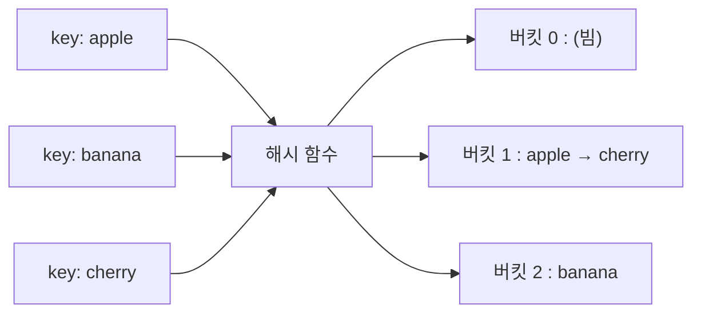

# 해싱 (Hashing)

> 최종 업데이트: 2026-07-29 | 자료구조 관점 (보안 해시는 별도 문서)

## 개념

**해싱**은 임의 크기의 입력을 **고정 크기의 값(해시값)으로 뭉개는 변환**이다. 그 변환을 수행하는 함수가 **해시 함수(hash function)**, 결과물이 **해시값**(해시코드·다이제스트)이다. 자료구조에서는 "빨리 찾으려고", 보안에서는 "원본을 숨기고 위변조를 막으려고" 쓰지만 원리는 하나다. **이 문서는 자료구조 관점(해시 테이블)**을 다루며, 보안 관점은 → [암호학적 해시와 비밀번호 해싱](../보안/비밀번호-해싱.md).

> 비유: **믹서기**다. 과일(데이터)을 넣고 갈면 주스(해시값)가 나온다. ① 같은 과일은 항상 같은 주스가 되고 ② 사과 한 조각만 바꿔도 주스 맛이 완전히 달라지며 ③ 주스를 보고 원래 과일 조합으로 되돌릴 수는 없다.

## 배경/역사

해싱의 뿌리는 1953년 1월, IBM 연구원 **한스 페터 룬(Hans Peter Luhn)**이 작성한 내부 메모다. 검색 속도를 높이려 데이터를 여러 **버킷(bucket)**에 나눠 담고 충돌은 체이닝으로 처리하는 아이디어를 처음 제시했다. `hashing`이라는 용어 자체는 이후 **로버트 모리스(Robert Morris)**의 논문을 통해 굳어졌다.

암호학적 해시는 별도 계보(MD5·SHA-1의 폐기, SHA-2/SHA-3 표준화)로 발전했으며, 그 역사와 비밀번호 저장은 → [암호학적 해시와 비밀번호 해싱](../보안/비밀번호-해싱.md)에서 다룬다.

## 핵심 성질

어디에 쓰든 좋은 해시 함수가 갖는 공통 성질이다.

| 성질 | 뜻 |
|------|-----|
| **고정 길이** | 입력이 1글자든 1GB든 출력 길이는 일정 |
| **결정적(deterministic)** | 같은 입력 → 항상 같은 해시 |
| **눈사태 효과(avalanche)** | 입력 1비트만 바뀌어도 출력은 절반가량 뒤집힘 |
| **단방향(one-way)** | 해시값에서 원본을 역산할 수 없음 |
| **고른 분포** | 출력이 특정 값에 몰리지 않고 골고루 퍼짐 |

## 해시 충돌 (Collision)

**서로 다른 입력이 같은 해시값을 갖는 것**이 충돌이다. 입력은 무한한데 출력은 고정 크기라 충돌은 **원리적으로 피할 수 없다**(비둘기집 원리). 그래서 해싱을 쓰는 쪽은 충돌을 어떻게 다루느냐가 관건이다.

- **자료구조**: 충돌이 나도 정상 동작하도록 **해결책**(체이닝 등)을 둔다.
- **보안**: 충돌을 **일부러 만들기 어렵게**(충돌 저항성) 설계한다. 충돌을 쉽게 만들 수 있으면 위조가 가능해진다.

## 자료구조에서의 해싱 — 해시 테이블

`HashMap`·`HashSet`이 대표다. key를 해시 함수에 넣어 **배열의 인덱스(버킷)**로 바꾸고, 그 자리에 바로 저장·조회한다. 처음부터 끝까지 훑지 않으니 평균 **O(1)**이다.

> 비유: 도서관에서 책 제목을 규칙으로 계산해 곧장 그 칸으로 가는 것. 한 권씩 훑으면(O(n)) 느리다.

**버킷(bucket)**은 그 배열의 **한 칸**, 데이터가 실제로 담기는 통이다. 옷장 서랍에 번호가 매겨진 것과 같다 — 해시 함수가 낸 해시값을 **버킷 개수로 나눈 나머지**(모듈로)가 서랍 번호(인덱스)가 되어, 그 칸에 저장된다.

| key | 해시값 | `% 8` | 들어갈 버킷 |
|-----|--------|-------|-----------|
| `apple` | 12345 | 1 | 버킷 1 |
| `banana` | 98762 | 2 | 버킷 2 |
| `cherry` | 55609 | 1 | 버킷 1 (apple과 같은 칸 → 충돌) |

"슬롯"이 아니라 "양동이(bucket)"라 부르는 건, 한 칸에 **여러 개를 던져 넣을 수 있어서**다 — 충돌하면 그 안에 매달아 둔다.



위에서 `apple`과 `cherry`가 같은 버킷 1로 떨어진 게 충돌이며, 연결해서 매다는 방식이 **체이닝**이다.

| 충돌 해결법 | 방식 |
|-------------|------|
| **체이닝(Separate Chaining)** | 같은 버킷에 연결 리스트/트리로 매달아 둠 (Java `HashMap`은 충돌 많으면 트리로 전환) |
| **개방 주소법(Open Addressing)** | 다음 빈 버킷을 찾아 이동(선형 탐사 등) |

**체이닝이 실제로 충돌을 푸는 방식**을 보자. 버킷 칸에 값을 직접 넣으면 나중 값이 먼저 값을 덮어써 유실된다. 체이닝은 칸에 값 대신 리스트를 두고 충돌 시 노드를 매달아, 덮어쓰지 않고 공존시킨다. 조회는 ① key를 해시해 **버킷으로 점프**(O(1)) → ② 그 버킷의 줄을 훑으며 **key를 하나씩 `equals`로 비교**해 정확한 것을 고른다. 버킷 번호가 같아도 key 자체는 다르므로(`apple` ≠ `cherry`) 구분된다 — Java `HashMap`이 `hashCode()`로 버킷을 찾고 `equals()`로 최종 확인하는 이유이며, 그래서 둘을 함께 오버라이드하라는 규약이 있다.

줄이 길어지면 순회가 O(n)으로 느려지므로, Java 8+ `HashMap`은 한 버킷의 노드가 **8개를 넘으면** 연결 리스트를 **레드-블랙 트리로 전환**해 O(log n)으로 개선한다(줄어들면 다시 리스트로).

| 버킷 안 상태 | 조회 성능 |
|-------------|----------|
| 충돌 없음 (1개) | O(1) |
| 리스트로 매달림 | O(n) — 최악 |
| 트리로 전환 (Java 8+) | O(log n) |

반대편 방식인 **개방 주소법**은 리스트를 매달지 않고 **배열 안에서 빈자리를 찾아 넣는다**(한 버킷 = 값 하나). 지정 주차 자리가 차 있으면 옆 빈자리로 옮겨 대는 것과 같다. 원래 갈 버킷이 차 있으면 정해진 규칙으로 다음 자리를 **탐사(probing)**한다.

| 탐사 방식 | 이동 규칙 | 특징 |
|-----------|----------|------|
| **선형 탐사(Linear)** | 다음 칸 +1, +2, +3... | 단순하나 데이터가 뭉침(군집화) |
| **제곱 탐사(Quadratic)** | +1², +2², +3²... | 군집 완화 |
| **이중 해싱(Double Hashing)** | 두 번째 해시로 간격 결정 | 가장 고르게 분산 |

조회도 같은 규칙으로 따라가다 key가 맞으면 반환하고, **빈 칸을 만나면 없음**으로 끝낸다. 단 삭제가 까다롭다 — 그냥 지우면 탐사 사슬이 끊겨 뒤에 밀려 저장된 값을 못 찾으므로, "삭제됨" 표시(**tombstone**)를 남긴다. 또 배열 안에 다 넣으니 load factor가 1을 못 넘는다. 보통 **0.5~0.7 임계치에 닿으면 더 큰 배열로 재해싱(rehash)**해 자리를 확보하며(쌓인 tombstone도 이때 청소된다), 리사이즈는 O(n)이지만 드물어 삽입은 평균 O(1)로 유지된다. 체이닝은 1을 넘어도 동작하지만, 개방 주소법은 자리가 물리적으로 필요해 **더 일찍·반드시** 늘려야 한다는 차이다.

| | 체이닝 | 개방 주소법 |
|---|--------|-----------|
| 저장 위치 | 버킷 밖 리스트 | 배열 안에 직접 |
| 충돌 시 | 노드 매달기 | 빈 버킷 찾아 이동 |
| 메모리 | 포인터 오버헤드 | 배열만 → 캐시 친화적 |
| load factor | 1 넘어도 동작 | 1 못 넘음, 낮게 유지 |
| 삭제 | 간단 | tombstone 필요 |
| 실제 예 | Java `HashMap` | Python `dict`·`set` |

```java
Map<String, Integer> stock = new HashMap<>();
stock.put("apple", 10);   // "apple".hashCode() → 버킷 결정
stock.get("apple");       // 같은 해시 → 같은 버킷 → 평균 O(1)
```

여기 쓰는 해시는 **빠르고 단순**하면 된다(Java `hashCode()`, MurmurHash 등). 보안 강도는 필요 없다 — 목적이 오직 속도라서다. 다만 충돌이 몰리면 O(1)이 O(n)으로 나빠지므로 **고른 분포**가 중요하다.

버킷 개수도 고정이 아니다. Java `HashMap`은 기본 **16개**로 시작해, 데이터가 차서 **load factor**(기본 0.75)를 넘으면 버킷을 2배로 늘리고 전부 재배치한다(**rehashing**). 버킷이 넉넉해야 한 칸에 몰리지 않아 O(1)이 유지된다.

## 보안에서의 해싱 (별도 문서)

암호학적 해시(단방향 지문)는 **비밀번호 저장·무결성 검증·디지털 서명**에 쓰인다. 자료구조용과 달리 **단방향성·충돌 저항성**이 필수이며, 비밀번호는 **암호화가 아니라 해싱**으로 저장하고(솔트 + 느린 함수), 요즘은 **Argon2id**가 권장이다.

> 암호학적 해시, 암호화 vs 해싱, 솔트·페퍼, bcrypt·Argon2id 실무는 → [암호학적 해시와 비밀번호 해싱](../보안/비밀번호-해싱.md)

## 관련 문서

- [암호학적 해시와 비밀번호 해싱](../보안/비밀번호-해싱.md) — 보안 관점의 해싱(단방향·솔트·Argon2id)
- [checksum.md](../../Linux/파일/checksum.md) — 파일 무결성 해시 실무(체크섬 검증)
- [Array.md](../자료구조/Array/Array.md) — 해시 테이블의 바탕이 되는 배열

## 출처

- [Hans Peter Luhn and the Birth of the Hashing Algorithm — IEEE Spectrum](https://spectrum.ieee.org/hans-peter-luhn-and-the-birth-of-the-hashing-algorithm)
- [Hash table — Wikipedia](https://en.wikipedia.org/wiki/Hash_table)
