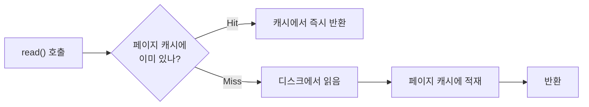

# OS 페이지 캐시 (Page Cache)

> 최종 업데이트: 2026-08-30 | Linux 커널 기준

## 개념

**페이지 캐시**는 리눅스 커널이 **디스크에서 읽거나 쓴 데이터를 유휴 RAM에 보관해두는 것**이다. 애플리케이션이 파일 I/O 시스템 콜을 부르면, 커널이 중간에서 "이미 메모리에 있나"를 판단해 처리한다 — **애플리케이션은 이 캐시의 존재를 몰라도 혜택을 받는다.**

> 도서관 사서 책상과 같다. 책(디스크 블록)을 한 번 꺼내오면 바로 서고에 돌려놓지 않고 **책상(RAM) 위에 잠깐 쌓아둔다.** 같은 책을 또 찾으면 서고까지 안 가고 책상에서 바로 건네준다. 책상이 꽉 차면 안 보는 책부터 서고에 반납한다.

## 배경/역사

Unix 계열 OS는 오래전부터 디스크 블록을 캐싱하는 **buffer cache**를 별도로 갖고 있었다. Linux는 초기엔 이 buffer cache(블록 I/O 캐싱)와 페이지 캐시(가상 메모리의 파일 매핑 캐싱)를 **분리해서 관리**했는데, **2.4 커널대에서 이 둘을 통합**해 하나의 페이지 캐시로 일원화했다 — 같은 파일 데이터가 두 캐시에 중복으로 떠 있는 비효율을 없앤 것이다. 이후 2.6 커널에서 역매핑(rmap) 등 메모리 회수 알고리즘이 정교해지며 현재 구조로 이어졌다.

## 동작 원리 — 읽기 캐싱과 쓰기 버퍼링



- **읽기 캐싱** — 같은 파일을 다시 읽으면 디스크 대신 메모리에서 즉시 반환한다.
- **쓰기 버퍼링** — 쓰기도 일단 페이지 캐시에 먼저 반영(**dirty page**)하고, 애플리케이션에는 즉시 성공을 반환한다. 실제 디스크 반영은 커널의 **flusher 스레드**가 백그라운드에서 나중에 처리한다. 그래서 쓰기 자체가 디스크 속도가 아니라 메모리 속도로 느껴진다.

## 왜 메모리 사용률이 높아도 위험하지 않은가 — 회수 가능(reclaimable)

페이지 캐시는 "예약"이 아니라 **회수 가능한 여유분**이다. 프로세스가 진짜 메모리를 요구하면 커널이 캐싱해둔 페이지를 즉시 반납(evict)하고 그 공간을 내준다 — 원본 데이터가 디스크에 그대로 남아 있으니 잃을 게 없다.

`free -h`의 `buff/cache`·`available` 필드가 바로 이걸 나타낸다. 필드별 상세 의미는 → [메모리 명령어](../Linux/시스템-리소스/메모리-명령어.md) 참고. `/proc/meminfo`에서는 `Cached`(페이지 캐시 크기)·`Dirty`(아직 디스크에 안 반영된 쓰기 버퍼)·`Writeback`(반영 진행 중) 필드로 더 세밀하게 확인할 수 있다.

```sh
cat /proc/meminfo | grep -Ei 'cached|dirty|writeback'
```

## 쓰기 지연의 위험 — 왜 fsync가 필요한가

쓰기 버퍼링은 빠르지만 대가가 있다. **dirty page가 아직 디스크에 반영되기 전에 시스템이 크래시하면, 그 쓰기는 유실된다.** 애플리케이션 입장에서는 이미 "쓰기 성공"을 받았는데도 실제로는 디스크에 없을 수 있다는 뜻이다.

그래서 **DB의 WAL(Write-Ahead Log)**처럼 내구성이 중요한 쓰기는 `fsync()`(또는 `O_DSYNC`)를 명시적으로 호출해 **"디스크에 실제로 반영될 때까지 기다린다."** 커널이 dirty page를 얼마나 오래·많이 쌓아둘지는 `vm.dirty_ratio`(전체 페이지 캐시 대비 dirty 허용 비율)·`vm.dirty_background_ratio`(백그라운드 flush를 시작하는 기준)로 튜닝한다.

## 우회하기 — `O_DIRECT`와 이중 캐싱

일부 DB(전통적인 Oracle, InnoDB의 특정 설정 등)는 **자체 버퍼 풀**을 이미 관리하고 있어서, OS 페이지 캐시까지 거치면 **같은 데이터가 두 곳(DB 버퍼 풀 + 페이지 캐시)에 중복 캐싱**되는 낭비가 생긴다. 이런 경우 `O_DIRECT` 플래그로 파일을 열어 **페이지 캐시를 우회하고 디스크에 직접** 읽고 쓴다. 대신 커널의 readahead·writeback 최적화를 못 받으므로, 캐싱·프리페치 책임을 애플리케이션(DB)이 전부 짊어져야 한다.

## 순차 읽기 최적화 — Readahead

커널은 파일 접근이 **순차적**이라고 판단하면, 요청받은 블록 뒤의 블록들을 **미리 읽어(prefetch) 페이지 캐시에 채워둔다.** 다음 읽기 요청이 왔을 때 이미 캐시에 있어 디스크를 안 가도 되는 구조다. **append-only 로그를 순차로 쓰고 읽는 시스템**(대표적으로 Kafka)이 이 최적화의 수혜를 크게 받는다.

## 적극적으로 의존하는 실전 사례

| 시스템 | 활용 방식 |
|--------|-----------|
| **Kafka** | 메시지를 JVM heap에 캐싱하지 않고 **OS 페이지 캐시가 최근 로그를 대신 들고 있게** 설계. 컨슈머 전송도 `sendfile()`로 페이지 캐시 → 네트워크 소켓 직접 전달(zero-copy), JVM을 거치지 않아 GC 부담도 없음 (→ [Kafka-Topic.md](../Kafka/Kafka-Topic.md#파티션-하나가-먹는-비용)) |
| **Elasticsearch/Lucene** | 세그먼트 파일을 자주 재읽어 페이지 캐시 의존도가 크며, 공식 문서에서도 heap보다 남는 RAM을 페이지 캐시용으로 남기라고 권장 |
| **Nginx** | 정적 파일을 반복 서빙할 때 두 번째 요청부터는 디스크 대신 캐시에서 응답 |
| **RDBMS** | 자체 Buffer Pool 아래 계층에서도 결국 이 캐시를 거침(단, `O_DIRECT` 사용 시는 예외) |

디스크에 파일 I/O를 하는 모든 리눅스 프로세스에 예외 없이 적용되는 **범용 메커니즘**이며, Kafka·Elasticsearch처럼 처리량이 중요한 시스템일수록 이를 의도적으로 더 활용하도록 설계되는 경향이 있다.

## 확인·실험 명령어

```sh
free -h                                   # buff/cache, available 확인
vmstat 1                                  # cache 컬럼 변화 실시간 관찰
cat /proc/meminfo | grep -Ei 'cached|dirty'

# ⚠️ 테스트 환경에서만 — 페이지 캐시를 강제로 비워 캐시 효과를 직접 체감
sync; echo 3 | sudo tee /proc/sys/vm/drop_caches
```

## 정리

> **OS 페이지 캐시 = 디스크 I/O를 줄이려고 커널이 유휴 RAM에 최근 읽기/쓰기 데이터를 보관해두는 범용 메커니즘.** 애플리케이션 몰래 동작하고, 필요하면 즉시 회수(reclaim)되므로 `free -h`의 `buff/cache`가 높아도 위험 신호가 아니다. 다만 쓰기 버퍼링(dirty page)은 크래시 시 유실 위험이 있어 내구성이 중요한 쓰기는 `fsync()`로 명시적으로 강제해야 한다. Kafka는 이 캐시를 로그 캐싱·zero-copy 전송에 적극 활용하도록 설계됐다.

## 관련 문서

- [Cache 개념](Cache-개념.md) — 캐시 계층 전체와 페이지 캐시의 위치
- [메모리 명령어](../Linux/시스템-리소스/메모리-명령어.md) — `free -h`의 `buff/cache`·`available` 필드 상세
- [Kafka-Topic.md](../Kafka/Kafka-Topic.md) — 페이지 캐시에 의존하는 파티션 설계
- [JVM](../Java/Java-Theory/JVM.md) — heap 대신 페이지 캐시를 쓰는 설계와 대비되는 JVM 메모리 구조

## 출처

- [kernel.org — Admin Guide: Memory Management Concepts](https://www.kernel.org/doc/html/latest/admin-guide/mm/concepts.html)
- Robert Love, *Linux Kernel Development* (3rd ed.) — buffer cache와 page cache의 통합 서술
- [Understanding the Linux Virtual Memory Manager (Mel Gorman)](https://www.kernel.org/doc/gorman/html/understand/understand013.html)
