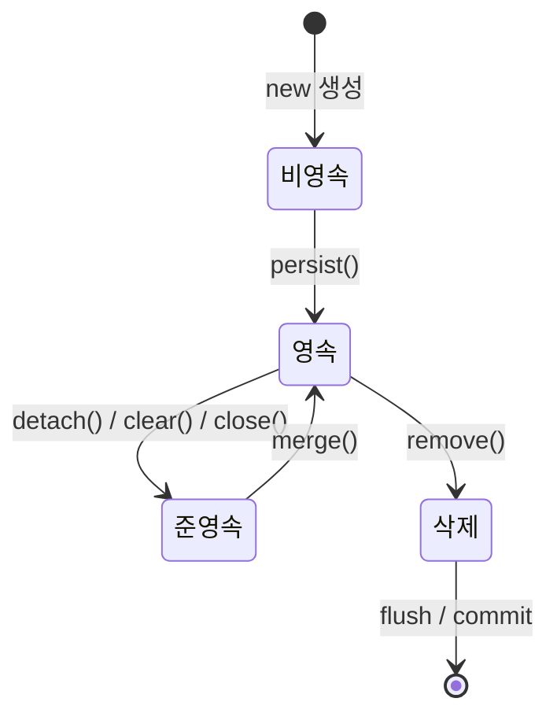
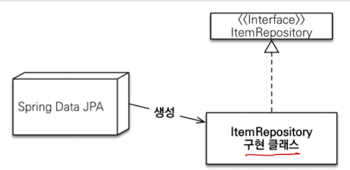

# JPA 개론

> 최종 업데이트: 2026-07-06 | Jakarta Persistence 3.2 / Hibernate ORM 7.x 기준
> 참고: https://docs.jboss.org/hibernate/orm/6.2/userguide/html_single/Hibernate_User_Guide.html#pc-persist

## 개념

JPA(Java Persistence API, 현 **Jakarta Persistence**)는 자바 진영의 **ORM 표준 인터페이스(스펙)**다. 객체(Object)와 관계형 DB의 테이블(Entity Relationship)을 매핑해, 자바 컬렉션을 다루듯 객체를 저장·조회하면 **SQL을 대신 만들어** 준다.

> 통역사에 비유할 수 있다. 개발자는 "객체" 언어로 말하고 DB는 "테이블·SQL" 언어로 알아듣는데, JPA가 그 사이에서 양방향 통역을 맡는다. 덕분에 개발자는 SQL을 일일이 쓰지 않고 객체 중심으로 코드를 짠다.

- **JPA = 표준 스펙(인터페이스)**, 이를 구현한 대표 구현체가 **Hibernate**다.
- 객체를 테이블과 매핑하고, 자바 컬렉션처럼 저장·조회한다.
- 반복적인 CRUD SQL을 자동 생성한다.

객체 모델과 관계형 모델은 상속·연관·식별 방식이 근본적으로 달라 완벽히 들어맞지 않는다(→ [객체-관계 임피던스 불일치](The-Object-Relational-Impedance-Mismatch.md)). JPA는 이 간극을 메우는 도구다.

## 배경/역사

| 시기 | 사건 |
|------|------|
| 2002 | **Gavin King**이 오픈소스 ORM **Hibernate** 첫 릴리스 (당시 EJB 엔티티 빈의 복잡함에 대한 반발) |
| 2006 | Hibernate의 설계가 표준으로 흡수됨 — **JPA 1.0**이 EJB 3.0(**JSR 220**)의 일부로 발표. King이 JBoss 대표로 표준화에 참여 |
| 2019 | Oracle이 Java EE를 **Eclipse Foundation**에 이관. `javax` 상표를 넘길 수 없어 **JPA → Jakarta Persistence**로 개명 |
| 2020~ | **3.0**(패키지 `javax.persistence` → `jakarta.persistence`) → 3.1(2022) → **3.2**(2024, Jakarta EE 11) |

즉 JPA는 "Hibernate가 잘 만들어 놓은 것을 표준화한" 스펙이다. 그래서 지금도 Hibernate가 사실상의 레퍼런스 구현이다.

> ⚠️ **`javax` → `jakarta` 전환은 실무에서 중요하다.** Spring Boot 3.0부터 Hibernate 6 + Jakarta Persistence를 쓰므로, 모든 `import javax.persistence.*`를 `import jakarta.persistence.*`로 바꿔야 한다. 구버전 예제를 복붙하다 컴파일이 안 되는 대표 원인이다.

## 영속성 컨텍스트 (Persistence Context)

JPA의 핵심 동작 원리. `EntityManager`가 관리하는 **엔티티 저장소**다. 엔티티를 DB에 바로 쓰지 않고, 이 논리적 공간에 올려두고 관리하다가 적절한 시점에 반영한다.

> 사무실 책상 위 작업 공간과 같다. 서류(엔티티)를 서류함(DB)에서 꺼내 책상(영속성 컨텍스트)에 올려두고 작업하다가, 퇴근(커밋) 시점에 한꺼번에 정리해 서류함에 넣는다. 작업 중엔 굳이 서류함을 매번 여닫지 않는다.

### 엔티티 생명주기

엔티티는 영속성 컨텍스트와의 관계에 따라 네 가지 상태를 오간다.



- **비영속 (new/transient)**: `new`로 생성만 한 상태. 영속성 컨텍스트와 무관
- **영속 (managed)**: `persist()` 또는 조회로 영속성 컨텍스트가 관리하는 상태
- **준영속 (detached)**: 관리되다 분리된 상태 (`detach()`, `clear()`, `close()`)
- **삭제 (removed)**: `remove()`로 삭제 요청된 상태

### 영속성 컨텍스트의 이점

**1차 캐시** — 같은 트랜잭션 내에서 동일 엔티티를 반복 조회하면 DB가 아닌 캐시에서 반환한다. 그래서 동일성까지 보장된다.
```java
em.find(User.class, 1L) == em.find(User.class, 1L)   // true (같은 인스턴스)
```

**변경 감지 (Dirty Checking)** — 영속 엔티티의 필드만 바꾸면, 커밋 시점에 JPA가 스냅샷과 비교해 변경을 감지하고 UPDATE를 자동 실행한다. `save()` 호출이 필요 없다.
```java
@Transactional
public void updateUserName(Long id, String newName) {
    User user = em.find(User.class, id);  // SELECT
    user.setName(newName);                // 커밋 시 자동 UPDATE (save 불필요)
}
```

**쓰기 지연 (Write-behind)** — SQL을 즉시 실행하지 않고 모아뒀다가 `flush()` 시점(트랜잭션 커밋, JPQL 실행 전, 수동 호출)에 한꺼번에 내보낸다. DB 왕복을 줄인다.

**지연 로딩 (Lazy Loading)** — 연관 엔티티를 실제 사용 시점까지 로딩을 미룬다. 그 자리엔 진짜 객체 대신 **프록시(가짜 대역)**를 넣어두고, 실제 접근하는 순간 쿼리가 나가 초기화된다. 실무에서는 **모든 연관관계를 LAZY로 설정**하고 필요할 때만 fetch join으로 가져온다.

> 프록시 동작 원리, 별개 프록시와 초기화, 타입 비교, `LazyInitializationException` 등 상세는 → [지연 로딩과 프록시](지연-로딩과-프록시.md)

### 주의: N+1 문제

연관 엔티티를 Lazy Loading으로 조회할 때, 부모 N건 조회 후 자식을 각각 1건씩 추가 조회하여 **총 N+1번의 쿼리**가 발생한다. 단일 연관(`@ManyToOne`)은 **fetch join / @EntityGraph**로, 컬렉션 연관(`@OneToMany`)은 **batch size**(`IN` 절로 묶기)로 해결한다.

> 발생 원리, 해결책별 SQL, fetch join의 페이징·컬렉션 함정, 감지 방법은 → [N+1 문제](N+1-문제.md)

## @Entity

JPA가 관리하는 객체로 지정. 엔티티라고 부른다.

- `@Id` 필수 — 식별자(PK) 매핑
- 기본 생성자 필수 (`protected` 이상) — JPA가 프록시·리플렉션으로 인스턴스를 만들기 때문
- `final` 클래스, `final` 필드 사용 불가 — 프록시가 상속으로 동작하기 때문

```java
@Entity
public class Post {
    @Id @GeneratedValue(strategy = GenerationType.IDENTITY)
    private Long id;

    @ManyToOne(fetch = FetchType.LAZY)   // 연관관계 매핑
    private Author author;
}
```

> 연관관계 매핑(`@ManyToOne`/`@OneToMany`, 주인과 `mappedBy`)의 상세는 → [연관관계 매핑](연관관계-매핑.md)

## JPQL

객체를 대상으로 하는 SQL. 테이블이 아닌 **엔티티를 대상**으로 쿼리한다.

```java
// SQL:  SELECT * FROM users WHERE name = '홍길동'
// JPQL: SELECT u FROM User u WHERE u.name = :name
```

- 조회 대상이 테이블 컬럼이 아니라 **엔티티와 그 필드**다.
- 값 주입은 `:name` 같은 **이름 기반 파라미터 바인딩**을 쓴다(문자열 연결 금지 — SQL 인젝션·성능 문제).

## 스프링 데이터 JPA

JPA를 편리하게 사용하도록 **추상화한 Spring 모듈**.

- `JpaRepository` 인터페이스 상속만으로 기본 CRUD 가능
- 메서드 이름으로 쿼리 자동 생성 (`findByNameAndStatus(...)`)
- 인터페이스 구현체를 **동적 프록시로 자동 생성** (개발자가 구현 클래스를 안 만들어도 됨)

> ※ 여기서 말하는 "프록시"는 앞의 **엔티티 프록시(지연 로딩용)**와는 다른, **리포지토리 구현체를 만들어 주는 프록시**다. 이름만 같고 목적이 다르니 혼동하지 말 것.



> 참고: https://docs.spring.io/spring-data/jpa/docs/current/reference/html/#jpa.query-methods.query-creation

### @Query
`JpaRepository`를 상속받은 상태에서 JPQL을 직접 쓰려면 `@Query`와 함께 사용한다.

### @Repository 필요한가?
Spring Data JPA는 `@Repository` 없이도 예외 변환(DB 예외 → Spring `DataAccessException`)을 해준다.

## 주의사항

- JPA의 원래 강점은 **CUD(insert, update, delete)** — 복잡한 조회에는 불리하다.
- 복잡한 조회는 **QueryDSL, jOOQ, Native SQL** 등과 조합하여 사용한다.

## 설정

### dependency
```gradle
implementation 'org.springframework.boot:spring-boot-starter-data-jpa'
```
JDBC 의존성도 함께 포함한다. Spring Boot 3.x부터는 Hibernate 6 + `jakarta.persistence` 네임스페이스를 사용한다.

### SQL 로깅 설정
```properties
# 하이버네이트 SQL 출력 (logger 사용 — 권장)
logging.level.org.hibernate.SQL=debug

# 바인딩 파라미터 확인 (Spring Boot 3.x / Hibernate 6+)
logging.level.org.hibernate.orm.jdbc.bind=TRACE
```
```properties
# System.out으로 출력 — 권장하지 않음
spring.jpa.show-sql=true
```

## 관련 문서

- [연관관계 매핑](연관관계-매핑.md) — @ManyToOne·@OneToMany 등 객체 연관 매핑
- [지연 로딩과 프록시](지연-로딩과-프록시.md) — 프록시 동작 원리와 지연 로딩 상세
- [N+1 문제](N+1-문제.md) — 지연 로딩이 유발하는 대표 성능 함정과 해결
- [객체-관계 임피던스 불일치](The-Object-Relational-Impedance-Mismatch.md) — JPA가 메우려는 근본 간극
- [JPA와 ORM 기술 비교](../데이터베이스-이론/JPA와-ORM-기술-비교.md) — ORM 기술 전반 비교
- [Entity와 Value Object](entity와-value-object.md) · [VO와 DTO](VO-와-DTO.md) — 엔티티 설계
