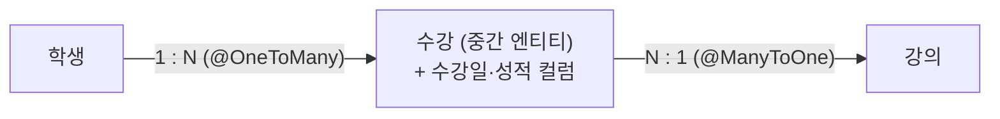

# JPA 연관관계 매핑 (Association Mapping)

> 최종 업데이트: 2026-07-06 | Jakarta Persistence 3.2 / Hibernate ORM 7.x 기준

## 개념

연관관계 매핑은 DB 테이블의 **외래키(FK) 관계**를, 객체 세계에서 **필드 참조**로 표현하는 것이다. 테이블은 `author_id` 같은 FK 컬럼으로 행을 잇지만, 객체는 `Author author`처럼 **다른 객체를 직접 참조**한다. JPA가 이 둘을 이어준다.

> 테이블은 주소록에 "친구 전화번호(FK)"를 적어두는 방식이고, 객체는 친구 본인을 옆에 두는 방식이다. 전화번호로 매번 찾아가는 대신(`JOIN`), 객체는 `post.getAuthor()`로 바로 손을 뻗는다.

### 읽는 법 — `@[나]To[상대]`

애너테이션 이름은 **내 입장에서 상대가 몇 개냐**로 읽는다.

- `@ManyToOne` = 나는 여럿(Many), 상대는 하나(One)
- `@OneToMany` = 나는 하나(One), 상대는 여럿(Many)

## 연관관계의 4가지 다중성

게시글(Post)과 작성자(Author)를 기준으로 정리한다.

| 애너테이션 | 관계 | 예시 | FK 위치 |
|-----------|------|------|---------|
| **@ManyToOne** | 나 여럿 → 상대 하나 | 게시글 여러 개 → 작성자 한 명 | 내 쪽 (`post.author_id`) |
| **@OneToMany** | 나 하나 → 상대 여럿 | 작성자 한 명 → 게시글 여러 개 | 상대 쪽 |
| **@OneToOne** | 1 : 1 | 회원 ↔ 프로필 | 둘 중 한쪽 |
| **@ManyToMany** | N : M | 학생 ↔ 강의 | 중간 테이블 |

`@ManyToOne`과 `@OneToMany`는 **같은 관계를 양쪽에서 본 것**이다. "게시글 여럿 : 작성자 하나"를 게시글 쪽에서 보면 `@ManyToOne`, 작성자 쪽에서 보면 `@OneToMany`다.

## 연관관계의 주인 (mappedBy)

가장 중요한 개념이다. 양방향 연관에서 두 객체가 서로를 참조하지만, **FK 컬럼을 실제로 가진 쪽만 "주인"**이고 주인만 FK를 변경할 수 있다. 반대쪽은 `mappedBy`로 "나는 주인이 아니라 거울일 뿐"임을 표시한다.

> 주인 판단은 간단하다 — **FK를 가진 쪽이 주인**이고, `@ManyToOne` 쪽이 항상 주인이다. `mappedBy`가 붙은 쪽은 읽기 전용.

```java
@Entity
public class Post {                    // Many 쪽, FK 보유 = 주인
    @Id @GeneratedValue
    private Long id;

    @ManyToOne(fetch = FetchType.LAZY)
    @JoinColumn(name = "author_id")    // 이 FK 컬럼을 관리
    private Author author;
}

@Entity
public class Author {                  // One 쪽, 읽기 전용(거울)
    @Id @GeneratedValue
    private Long id;

    @OneToMany(mappedBy = "author")    // "Post.author가 주인"을 가리킴
    private List<Post> posts = new ArrayList<>();
}
```

`mappedBy`의 값은 **주인 엔티티에서 나를 가리키는 필드명**(`Post`의 `author` 필드)이다. 여기서 흔한 실수가 나온다.

```java
post.setAuthor(author);       // FK 변경됨 ✅ (주인이므로)
author.getPosts().add(post);  // DB 반영 안 됨 ❌ (거울이라 무시됨)
```

### 연관관계 편의 메서드

양방향에서는 한 번에 양쪽을 맞춰주는 메서드를 두어 실수를 방지한다.

```java
public void addPost(Post post) {   // Author에 정의
    posts.add(post);               // 거울 쪽
    post.setAuthor(this);          // 주인 쪽 (실제 FK 반영)
}
```

## 방향 — 단방향 vs 양방향

- **단방향**: 한쪽만 참조 (`Post`만 `author`를 가짐). **대부분 이걸로 충분하다.**
- **양방향**: 서로 참조 (`Author`도 `posts`를 가짐). 반대 방향 탐색이 실제로 필요할 때만 추가한다.

양방향은 관리 포인트(주인·거울 동기화)가 늘어나므로, 필요해지기 전까지는 단방향으로 두는 것이 간결하다.

## 다중성별 사용법

### @ManyToOne — 가장 기본이자 안전

FK를 직접 쥔 주인이라 동작이 예측 가능하다. 대부분의 연관은 여기서 시작한다.
```java
@ManyToOne(fetch = FetchType.LAZY)
@JoinColumn(name = "author_id")
private Author author;
```

### @OneToMany — 양방향의 거울, 또는 단방향 주의

보통 `@ManyToOne`의 반대편(거울)으로 쓴다. `@OneToMany` **단방향**은 FK가 상대 테이블에 있어 UPDATE가 따로 나가는 등 비효율이 있으니, 되도록 `@ManyToOne`을 주인으로 두는 양방향을 쓴다.

### @OneToOne — FK 주인을 한쪽에

1:1은 FK를 어느 쪽에 둘지 정한다. 주로 조회가 잦은 쪽에 FK를 둔다.
```java
@OneToOne(fetch = FetchType.LAZY)
@JoinColumn(name = "profile_id")
private Profile profile;
```

### @ManyToMany — 지양하고 중간 엔티티로

`@ManyToMany`는 편해 보이지만 실무에선 거의 쓰지 않는다. 중간 테이블에 **추가 컬럼(가입일·수량·성적 등)을 넣을 수 없고**, 나가는 쿼리를 예측하기 어렵기 때문이다. **중간 엔티티를 직접 만들어 `@ManyToOne` 두 개로 풀어낸다.**



```java
@Entity
public class Enrollment {          // 중간 엔티티
    @ManyToOne private Student student;
    @ManyToOne private Course course;
    private LocalDate enrolledAt;  // ← 추가 정보를 담을 수 있다
}
```

## 로딩 전략 (fetch)

각 애너테이션은 기본 로딩 전략이 다르다. **실무에서는 전부 LAZY로 명시**한다.

| 연관 | JPA 기본 fetch |
|------|----------------|
| `@ManyToOne`, `@OneToOne` | EAGER (즉시) → **LAZY로 바꿔 명시** |
| `@OneToMany`, `@ManyToMany` | LAZY (지연) |

연관을 잘못 다루면 조회 성능이 급격히 나빠진다(→ [N+1 문제](N+1-문제.md)). 프록시와 지연 로딩의 동작은 → [지연 로딩과 프록시](지연-로딩과-프록시.md).

## 영속성 전이와 고아 객체 (cascade · orphanRemoval)

연관 엔티티의 생명주기를 부모에 묶는 옵션이다.

```java
@OneToMany(mappedBy = "author", cascade = CascadeType.ALL, orphanRemoval = true)
private List<Post> posts = new ArrayList<>();
```

- **cascade** — 부모의 저장·삭제를 자식에게 전이한다. `author`를 저장하면 `posts`도 함께 저장.
- **orphanRemoval** — 컬렉션에서 빠진 자식을 DB에서도 삭제한다. `posts.remove(post)` → 해당 행 DELETE.

> ⚠️ 이 옵션들은 자식이 **부모에게만 종속된 소유 관계**일 때만 쓴다. 다른 곳에서도 참조하는 공유 엔티티에 걸면, 의도치 않은 삭제로 이어진다.

## 관련 문서

- [JPA 개론](JPA-개론.md) — 영속성 컨텍스트 등 JPA 기본 원리
- [지연 로딩과 프록시](지연-로딩과-프록시.md) — 연관 로딩 전략과 프록시 동작
- [N+1 문제](N+1-문제.md) — 연관 조회에서 터지는 대표 성능 함정
- [외래키 (Foreign Key)](../데이터베이스-이론/foreign-key.md) — 연관관계의 DB 측 기반
