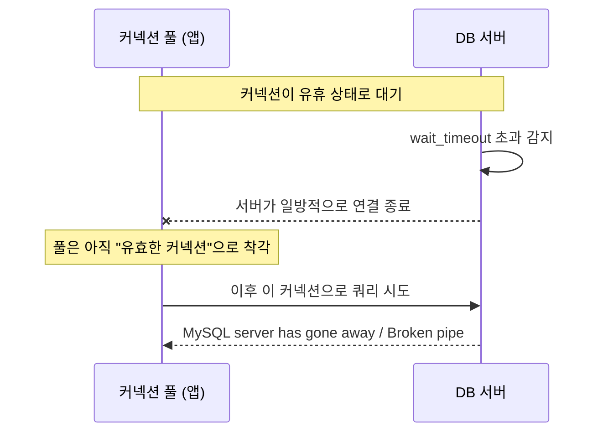

# DB 커넥션 — 서버 세션과 타임아웃 관리

> 최종 업데이트: 2026-07-05 | MySQL 8.4 / AWS RDS·Aurora 기준

## 개념

DB 커넥션은 클라이언트와 DB 서버 사이에 맺어진 **하나의 연결(세션)** 이다. DB 서버 입장에서 커넥션 하나는 **소켓 + 세션 메모리 + 서버 스레드**를 점유하는 유한한 자원이다. 그래서 서버는 "동시에 몇 개까지 받을지(`max_connections`)"와 "놀고 있는 연결을 언제 끊을지(`wait_timeout`)"를 스스로 통제한다.

> 식당의 좌석과 같다. 좌석(커넥션)은 유한하고(`max_connections`), 자리만 잡고 주문 안 하는 손님은 일정 시간 뒤 내보낸다(`wait_timeout`). 손님을 자리로 안내하고 회전시키는 건 홀 매니저(**커넥션 풀**)의 몫이다.

이 문서는 **DB 서버가 커넥션을 어떻게 통제하는가(서버 관점)** 를 다룬다. 애플리케이션이 커넥션을 풀링해 재사용하는 클라이언트 관점은 → [커넥션 풀](../../Java/Java-Database/커넥션-풀.md) 참고. 실무 장애의 상당수는 **이 둘의 설정이 어긋날 때** 터진다.

## max_connections — 동시 연결 상한

`max_connections`는 DB 서버가 **동시에 허용하는 최대 커넥션 수**다. 이 값을 넘어서면 새 연결 요청은 `ERROR 1040 (HY000): Too many connections`로 거절된다.

```sql
SHOW VARIABLES LIKE 'max_connections';      -- 현재 상한
SHOW STATUS LIKE 'Threads_connected';       -- 지금 열린 연결 수
SHOW STATUS LIKE 'Max_used_connections';    -- 기동 후 최대치(피크)
```

이 상한을 소모하는 건 애플리케이션 풀만이 아니다. **아래 모두가 같은 `max_connections`를 나눠 쓴다.**

- 애플리케이션 커넥션 풀이 점유한 연결
- DBA·모니터링 툴이 접속한 세션
- 복제(replication), 백업, 메인터넌스 작업
- (Aurora의 경우) 내부·백그라운드 스레드

그래서 여러 애플리케이션 인스턴스가 각자 큰 풀을 잡으면 상한이 금세 고갈된다. **인스턴스 수 × 풀 크기 + 여유분(DBA·복제 등)** 이 `max_connections`를 넘지 않도록 설계해야 한다.

### 기본값과 RDS/Aurora 산정 공식

MySQL 자체 기본값은 낮게 잡혀 있고, RDS·Aurora는 **인스턴스 메모리에 비례한 공식**으로 자동 산정한다. 즉 큰 인스턴스일수록 상한도 커진다.

| 환경 | 기본 `max_connections` |
|------|------------------------|
| MySQL (자체 기본) | **151** (고정) |
| RDS for MySQL 8.x | `{DBInstanceClassMemory/12582880}` |
| Aurora MySQL | `GREATEST({log(DBInstanceClassMemory/805306368)*45}, {log(DBInstanceClassMemory/8187281408)*1000})` |

> ⚠️ RDS/Aurora의 값은 **인스턴스 클래스마다 다르다.** 예전 문서에 "5,000개"처럼 특정 숫자가 박혀 있다면 그건 특정 인스턴스의 계산 결과일 뿐, 일반값이 아니다. 실제 값은 위 공식 또는 파라미터 그룹에서 확인한다(콘솔: **RDS > 파라미터 그룹 > max_connections**).

## 세션 타임아웃 — wait_timeout / interactive_timeout

DB 서버는 **유휴(idle) 커넥션을 무한정 살려두지 않는다.** 일정 시간 아무 쿼리도 없으면 서버가 그 세션을 일방적으로 끊는다. 이 시간을 정하는 게 아래 두 변수다.

| 변수 | 대상 | 기본값 |
|------|------|--------|
| `wait_timeout` | 비대화형 연결(애플리케이션·커넥션 풀) | 28800초(8시간) |
| `interactive_timeout` | 대화형 연결(mysql CLI 등) | 28800초(8시간) |

커넥션 풀이 맺는 연결은 **비대화형**이므로 실무에서 중요한 건 `wait_timeout`이다.

```sql
SHOW VARIABLES LIKE 'wait_timeout';
SHOW VARIABLES LIKE 'interactive_timeout';
```

## 유휴 커넥션이 끊기는 문제 (stale connection)

가장 흔한 장애 패턴이다. **DB 서버의 `wait_timeout`이 커넥션 풀의 유휴 유지 시간보다 짧을 때** 발생한다. 서버는 연결을 끊었는데 풀은 그 사실을 모른 채, 죽은 커넥션을 빌려줘 쿼리를 날리는 상황이다.



이때 애플리케이션은 아래 같은 오류를 만난다.

- `MySQL server has gone away`
- `Broken pipe`
- `Communications link failure` (Connector/J)

## 커넥션 풀 쪽 대응

해결의 핵심은 하나다 — **DB 서버가 끊기 전에, 풀이 먼저 그 커넥션을 정리하거나 살려두는 것.** HikariCP 기준 관련 옵션은 다음과 같다. (옵션 자체의 일반 설명은 → [커넥션 풀](../../Java/Java-Database/커넥션-풀.md))

| 옵션 (HikariCP) | 역할 | wait_timeout과의 관계 |
|-----------------|------|------------------------|
| **maxLifetime** | 커넥션 최대 수명. 초과 시 풀에서 교체 | **wait_timeout보다 짧게** (가장 중요) |
| **idleTimeout** | 유휴 커넥션을 풀에서 제거하는 시간 | 보통 maxLifetime보다 짧게 |
| **keepaliveTime** | 유휴 커넥션에 주기적 핑을 보내 연결 유지·검증 | wait_timeout보다 훨씬 짧게 |
| **connectionTimeout** | 풀에서 커넥션을 빌리려 기다리는 최대 시간 | (상한 도달 시 대기·실패 판단용) |

### 핵심 원칙: maxLifetime < wait_timeout

```yaml
# 예) DB wait_timeout = 1800초(30분)라면
spring.datasource.hikari.max-lifetime: 1770000   # 29분 30초 (30초 여유)
spring.datasource.hikari.keepalive-time: 300000  # 5분마다 핑
```

`maxLifetime`을 `wait_timeout`보다 몇십 초 짧게 두면, 서버가 끊기 전에 풀이 먼저 커넥션을 갱신하므로 stale connection을 원천 차단한다. `keepaliveTime`은 유휴 커넥션을 주기적으로 건드려 서버 타임아웃 자체를 리셋하는 보조 수단이다.

> **connectionTestQuery(예: `SELECT 1`)는 요즘 거의 불필요하다.** JDBC4 드라이버(현대 MySQL/PostgreSQL 드라이버 전부)에서는 HikariCP가 `Connection.isValid()`로 커넥션을 검증하므로, `connectionTestQuery`를 명시하면 오히려 최적화를 우회해 느려진다. 특별한 이유가 없으면 설정하지 않는다.

한 가지 더 — `connectionTimeout` 초과 예외(`Connection is not available`)가 **자주** 뜬다면, 그건 timeout이 짧아서가 아니라 **풀의 모든 커넥션이 항상 사용 중**이라는 신호다. 이 경우 timeout을 늘릴 게 아니라 `maximumPoolSize`가 충분한지, 느린 쿼리가 커넥션을 오래 잡는지를 먼저 봐야 한다.

## 모니터링

서버와 풀 양쪽을 함께 봐야 한다. 한쪽만 보면 원인을 놓친다.

**DB 서버 측**
```sql
SHOW STATUS LIKE 'Threads_connected';    -- 현재 연결 수
SHOW STATUS LIKE 'Threads_running';      -- 실제 쿼리 실행 중인 수
SHOW STATUS LIKE 'Max_used_connections'; -- 피크 연결 수 (max_connections 대비 여유 판단)
SHOW PROCESSLIST;                        -- 개별 세션 상태·유휴 시간
```

- **AWS RDS/Aurora**: CloudWatch `DatabaseConnections` 지표로 추이 감시, **Performance Insights**로 세션·대기 이벤트 분석
- `Max_used_connections / max_connections` 비율이 상시 높으면 상한 증설 또는 풀 크기 재검토 신호

**커넥션 풀 측 (HikariCP)**

Spring Boot Actuator + Micrometer로 풀 상태를 지표로 노출할 수 있다.

- `hikaricp_connections_active` — 사용 중 커넥션
- `hikaricp_connections_idle` — 유휴 커넥션
- `hikaricp_connections_pending` — 커넥션을 못 빌려 대기 중인 스레드 수 (**0보다 크면 풀 부족 신호**)
- `hikaricp_connections_timeout_total` — 대여 실패 누적

## 관련 문서

- [커넥션 풀 (Connection Pool)](../../Java/Java-Database/커넥션-풀.md) — 애플리케이션(클라이언트) 관점의 풀 개념·HikariCP 설정 전반
- [database-basic.md](database-basic.md) — 데이터베이스 기본 개념
