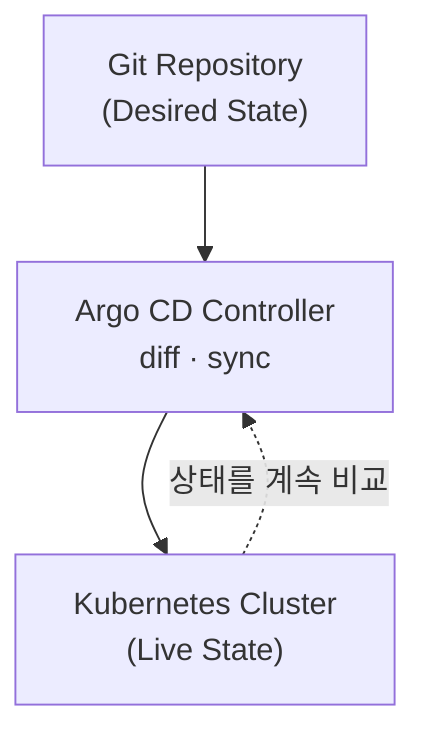
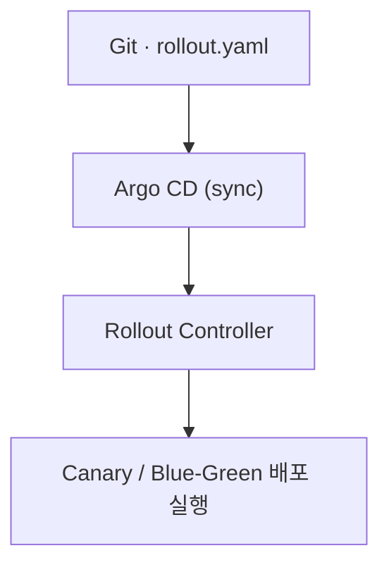

# Argo 개념 정리

> 최종 업데이트: 2026-07-29 | Argo CD / Rollouts 기준

## 개념

Argo는 Kubernetes 환경에서 **애플리케이션 배포·워크플로우 실행·이벤트 자동화**를 **선언적(Declarative)** 으로 운영하기 위한 컨트롤러 기반 오픈소스 제품군이다.

핵심 철학은 하나다 — **운영자는 "원하는 상태(Desired State)"를 선언하고, Argo는 실제 클러스터 상태를 그에 맞게 지속적으로 동기화**한다.

> 온도조절기(thermostat)와 같다. 사람은 "26도"라는 **목표만 설정**하고, 조절기가 현재 온도를 계속 재서 목표에 맞춘다. Argo도 "이 상태가 되어야 한다"만 Git에 선언하면, 실제 클러스터를 거기에 맞춰 계속 조정한다.

## Argo는 단일 제품이 아니다

Argo는 하나의 툴이 아니라 **역할별로 분리된 여러 컴포넌트의 집합**이다.

| 컴포넌트 | 역할 |
|----------|------|
| **Argo CD** | GitOps 기반 애플리케이션 배포 |
| **Argo Rollouts** | Canary / Blue-Green 배포 전략 |
| **Argo Workflows** | 배치·파이프라인 워크플로우 엔진 |
| **Argo Events** | 이벤트 기반 트리거 시스템 |

실무에서는 보통 **Argo CD + Argo Rollouts** 조합을 핵심으로 쓴다.

## Argo CD — GitOps 배포 컨트롤러

### 역할

- Kubernetes 클러스터 안에서 동작하는 **GitOps 컨트롤러**
- **Git 저장소를 유일한 진실(Single Source of Truth)** 로 사용
- Git에 정의된 매니페스트와 실제 클러스터 상태를 지속적으로 **비교(diff)** 하고, 불일치 시 **동기화(sync)**

즉 Argo CD는 "배포 도구"라기보다 **상태를 맞추는 컨트롤 플레인**에 가깝다. `kubectl apply`를 사람이 직접 치던 구조에서 → **Git commit = 배포 트리거** 구조로 바뀐다.

### 동작 흐름



### Application과 ApplicationSet

Argo CD가 배포를 다루는 단위가 **Application**이다.

- **Application** — "이 Git 경로의 매니페스트를 이 클러스터·네임스페이스에 배포해라"라는 **배포 정의 하나**
- **ApplicationSet** — 이 Application을 **템플릿으로 여러 개 자동 생성**하는 상위 컨트롤러. 환경·클러스터·벤더마다 반복되는 App을 목록·제너레이터로 찍어낸다. (상세 → [ApplicationSet](ApplicationSet.md))

## Argo Rollouts — 배포 전략 컨트롤러

### 필요한 이유

Kubernetes 기본 `Deployment`는 배포 전략이 단순하다(`RollingUpdate`, `maxSurge`/`maxUnavailable`). 하지만 실무에서는 아래가 필요하다.

- Canary 단계별 트래픽 증가
- 메트릭 기반 자동 중단(rollback)
- Blue-Green + 수동 승인

이를 위해 **Argo Rollouts**가 등장했다.

### 역할

- `Deployment`를 대체하는 **CRD(`Rollout`)**
- 실제 Pod/ReplicaSet은 그대로 쓰되, **배포 방식만 컨트롤**
- 즉 **애플리케이션이 아니라 "배포 과정"을 선언적으로 정의**한다

```
Step 1: Canary 10%
Step 2: Metric 체크 (error_rate < 1%)
Step 3: Canary 50%
Step 4: 수동 승인
Step 5: Full traffic
```

## Argo CD + Rollouts 관계 (중요)

이 둘은 **역할이 완전히 다르다.**

| 구분 | Argo CD | Argo Rollouts |
|------|---------|---------------|
| 책임 | **무엇을** 배포할지 | **어떻게** 배포할지 |
| 대상 | App 전체 | 특정 워크로드 |
| 트리거 | Git 변경 | 배포 이벤트 |

실제 운영 구조는 이렇게 맞물린다.



그래서 **둘 중 하나만으로는 완전한 GitOps 배포가 되지 않는다** — Argo CD가 "무엇을"을 Git에서 가져오고, Rollouts가 "어떻게"를 실행한다.

## Argo Workflows / Events

| 컴포넌트 | 설명 |
|----------|------|
| **Argo Workflows** | Kubernetes-native 배치·파이프라인 엔진. CI 이후 데이터 처리·ML 파이프라인 등에 사용, **Jenkins 대체재**로도 쓰임 |
| **Argo Events** | Webhook·S3·Kafka 등의 이벤트 수신 → **Workflow 트리거** |

## Kubernetes와의 관계

Argo는 Kubernetes 위에서 **컨트롤러 패턴**으로 동작한다.

- Kubernetes API를 지속적으로 **감시(watch)**
- **CRD 상태를 reconciliation loop**로 목표에 맞춤
- 사람 개입 최소화, 재현성 극대화

> 위 컴포넌트들이 다루는 `Application`·`Rollout` 등은 전부 **Argo가 K8s에 추가한 CRD**다. CRD라는 확장 판은 K8s가 주고, 그 위의 리소스·컨트롤러는 Argo가 제공한다. (→ [ApplicationSet](ApplicationSet.md)의 "K8s 기본이 아니다")

## 관련 문서

- [ApplicationSet](ApplicationSet.md) — Application을 템플릿으로 N개 자동 생성
- [Argo 설치](Argo-설치.md) · [주요 명령어](주요-명령어.md) — 설치·운영
- [쿠버네티스 개념](../kubernetes/쿠버네티스-개념.md) — Argo가 올라가는 K8s 기반
- [Helm 개념](../Helm/Helm-개념.md) — 매니페스트 템플릿화(Argo CD와 함께 사용)
