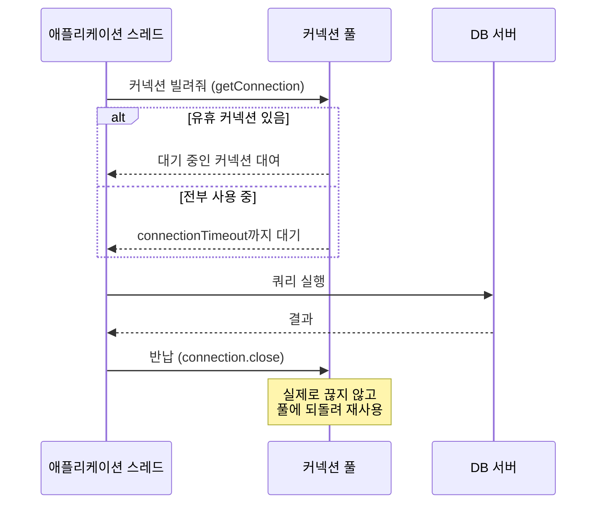

# 커넥션 풀 (Connection Pool)

> 최종 업데이트: 2026-07-05 | HikariCP 7.x, Spring Boot 4.1, Java 25 LTS 기준

## 개념

커넥션 풀은 **DB 커넥션을 미리 여러 개 만들어두고 재사용하는 창고**다. 애플리케이션이 DB 작업이 필요할 때마다 새 연결을 맺는 게 아니라, 풀에서 이미 열려 있는 커넥션을 **빌려 쓰고(borrow) → 반납(return)** 하는 방식으로 동작한다.

> 카페의 컵과 같다. 손님이 올 때마다 컵을 새로 사서 쓰고 버리면(매번 새 연결) 느리고 비싸다. 대신 컵 30개를 미리 사두고 씻어서 돌려쓰면(풀) 빠르고 경제적이다. 다만 컵이 30개뿐이라, 31번째 손님은 컵이 반납될 때까지 기다려야 한다.

핵심은 **커넥션 풀은 DB 엔진의 기능이 아니라, DB에 접속하는 애플리케이션(클라이언트) 쪽에서 관리하는 기법**이라는 점이다. DB 서버는 연결을 받아줄 뿐, 풀을 만드는 주체가 아니다.

## 배경/역사

### 왜 필요한가 — 커넥션 생성 비용

DB 커넥션 하나를 새로 맺는 건 생각보다 무거운 작업이다. 매 연결마다 아래 과정을 거친다.

| 단계 | 내용 |
|------|------|
| TCP 3-way 핸드셰이크 | 네트워크 연결 수립 |
| DB 인증 | 계정/비밀번호 검증, 권한 확인 |
| 세션 초기화 | 세션 변수, 캐릭터셋, 타임존 등 세팅 |

이 과정에 보통 수~수십 ms가 든다. 요청마다 이걸 반복하면 **실제 쿼리보다 연결 맺고 끊는 데 시간이 더 걸리는** 상황이 생기고, 트래픽이 몰리면 DB가 연결 관리만 하다 뻗는다. 커넥션 풀은 이 비용을 **애플리케이션 시작 시점에 한 번만 지불**하고, 이후로는 열려 있는 연결을 계속 재사용한다.

### HikariCP의 등장

Java 진영의 사실상 표준 커넥션 풀은 **HikariCP**다. **Brett Wooldridge**가 2012년경 프로토타입을 만들다 기존 풀(Commons DBCP, Tomcat JDBC 등)에서 데드락과 커넥션 상태 문제를 겪었고, 기존 코드가 수천 줄로 지나치게 복잡한 것에 질려 직접 만들었다. 이름 `Hikari`는 일본어로 **빛(光)** — "빠르다"는 의미를 담았다.

2015년 **Wix 엔지니어링 팀**이 HikariCP로 전환한 후기를 블로그에 올리며 폭발적으로 알려졌고, **Spring Boot 2.0(2018)부터 기본 커넥션 풀**로 채택되어 현재까지 유지되고 있다.

## 동작 방식

애플리케이션 스레드는 커넥션을 직접 만들지 않고, 풀에서 빌린 뒤 쿼리를 실행하고 반드시 반납한다.



여기서 함정 하나 — 풀 환경에서 `connection.close()`는 **실제로 연결을 끊는 게 아니라 풀에 반납**하는 동작이다. 그래서 커넥션을 쓴 뒤 반드시 `close()`(또는 try-with-resources)로 반납해야 한다. 반납을 빼먹으면 그 커넥션은 영원히 대여 상태로 남아(**커넥션 누수, connection leak**) 풀이 고갈된다.

```java
// try-with-resources — 블록을 벗어나면 자동 반납
try (Connection conn = dataSource.getConnection()) {
    // 쿼리 실행
} // conn.close() 자동 호출 → 풀에 반납
```

## 주요 커넥션 풀 구현체

커넥션 풀은 Java만의 것이 아니라 언어/플랫폼을 가리지 않는 범용 패턴이다.

| 구분 | 대표 구현체 | 비고 |
|------|-------------|------|
| Java | **HikariCP** | Spring Boot 기본, 사실상 표준 |
| Java | Tomcat JDBC Pool | 과거 Spring Boot 1.x 기본 |
| Java | Commons DBCP2 | 오래된 프로젝트에서 여전히 사용 |
| 미들웨어 | PgBouncer, ProxySQL | DB 앞단에 세우는 **독립 프로세스**형 풀 |
| 기타 언어 | pg-pool(Node), SQLAlchemy Pool(Python), `database/sql`(Go) | 언어별 내장/라이브러리 |

맨 아래 **PgBouncer** 같은 건 애플리케이션도 Java도 아닌, DB 앞에 세우는 독립 프로그램이다. 이것만 봐도 커넥션 풀이 특정 언어의 소유물이 아님이 드러난다.

## HikariCP 핵심 설정

옵션별로 짚는다. 괄호 안은 기본값이다.

**maximumPoolSize** (기본 10) — 풀이 가질 수 있는 최대 커넥션 수. 가장 중요한 값. 성능을 좌우한다.
```yaml
spring.datasource.hikari.maximum-pool-size: 10
```

**minimumIdle** (기본 = maximumPoolSize) — 유휴 상태로 유지할 최소 커넥션 수. HikariCP 저자는 **`minimumIdle`을 따로 만지지 말고 `maximumPoolSize`와 같게 두는 고정 크기 풀**을 권장한다. 순간 트래픽이 몰릴 때 커넥션을 새로 만드느라 지연되는 것을 막기 위함이다.
```yaml
spring.datasource.hikari.minimum-idle: 10
```

**connectionTimeout** (기본 30000ms) — 풀에서 커넥션을 못 빌리고 기다릴 수 있는 최대 시간. 초과하면 `SQLException`을 던진다. 이 예외가 자주 뜬다면 timeout을 늘릴 게 아니라 **`maximumPoolSize`가 충분한지부터** 봐야 한다.
```yaml
spring.datasource.hikari.connection-timeout: 30000
```

**idleTimeout** (기본 600000ms=10분) — 커넥션이 유휴 상태로 있을 수 있는 최대 시간. 초과하면 풀에서 제거. `minimumIdle < maximumPoolSize`일 때만 의미가 있다.

**maxLifetime** (기본 1800000ms=30분) — 커넥션의 최대 수명. 이 시간이 지나면 (사용 중이 아닐 때) 풀에서 제거하고 새 커넥션으로 교체한다. **DB 서버의 `wait_timeout`보다 몇 초 짧게** 설정하는 게 핵심 — 그래야 DB가 먼저 연결을 끊어 생기는 `MySQL server has gone away`류 오류를 예방한다. (→ [DB-커넥션.md](../../Database/데이터베이스-이론/DB-커넥션.md))
```yaml
spring.datasource.hikari.max-lifetime: 1770000   # wait_timeout(예:1800000)보다 짧게
```

**keepaliveTime** (기본 0=비활성) — 유휴 커넥션에 주기적으로 keepalive 핑을 보내 DB가 연결을 끊지 못하게 유지한다. `maxLifetime`보다 작게 설정해야 한다.

**poolName** — 풀 이름. 로그/모니터링에서 어느 풀인지 식별할 때 유용하다.
```yaml
spring.datasource.hikari.pool-name: MainDbPool
```

## maxLifetime vs idleTimeout — 헷갈리는 두 옵션

이름이 비슷해 자주 혼동되지만, **재는 기준 시점이 다르다.**

- **maxLifetime** = 커넥션이 **얼마나 오래 살았나** (생성 시점부터의 총수명)
- **idleTimeout** = 커넥션이 **얼마나 안 쓰였나** (마지막 반납 후 방치 시간)

| 구분 | maxLifetime | idleTimeout |
|------|-------------|-------------|
| 재는 것 | 커넥션 **생성 순간**부터의 총 시간 | **마지막 반납 후** 노는 시간 |
| 타이머 리셋 | 없음 (태어나면 끝까지 카운트) | 빌려 쓸 때마다 0으로 리셋 |
| 사용 중인 커넥션 | 타이머는 흐름 (폐기는 유휴로 돌아왔을 때) | 사용 중이면 대상 아님 |
| 목적 | 오래된 커넥션 **주기적 물갈이** | 한산할 때 **남는 커넥션 반납** |
| 기본값 | 1800000ms(30분) | 600000ms(10분) |

핵심은 하나다 — **maxLifetime은 쓰이고 있어도 나이를 먹고, idleTimeout은 안 쓰일 때만 시계가 돈다.** 그래서 바쁘게 계속 도는 커넥션은 idleTimeout엔 안 걸려도 maxLifetime엔 결국 걸려 교체된다. DB가 오래된·유휴 연결을 끊는 문제(`wait_timeout`) 방어는 **maxLifetime의 몫**이다.

> ⚠️ **idleTimeout은 `minimumIdle < maximumPoolSize`일 때만 동작한다.** HikariCP 권장 기본인 고정 크기 풀(`minimumIdle == maximumPoolSize`)에서는 풀이 항상 최대치를 유지하므로 커넥션이 놀아도 줄이지 않는다 → idleTimeout은 사실상 무의미. 대부분의 프로덕션에서 실질적으로 작동하는 물갈이 장치는 **maxLifetime**이다.

## 풀 사이즈는 왜 크게 잡으면 안 되나

직관과 반대로, **커넥션 풀은 크다고 빠르지 않다.** 커넥션이 많아지면 DB 서버의 컨텍스트 스위칭과 락 경합이 심해져 오히려 처리량이 떨어진다. DB의 `max_connections`도 유한한 자원이라, 여러 애플리케이션 인스턴스가 각자 큰 풀을 잡으면 금세 고갈된다.

HikariCP 위키가 제시하는 출발점 공식은 다음과 같다. (PostgreSQL 커뮤니티에서 유래)

> **connections = ((core_count × 2) + effective_spindle_count)**
> - `core_count`: DB 서버의 CPU 코어 수 (하이퍼스레딩 제외)
> - `effective_spindle_count`: 디스크 수 (SSD면 대체로 1~2로 취급)

예컨대 4코어 + SSD DB라면 `4×2 + 1 ≈ 9`, 즉 풀 사이즈 **10 안팎**이 합리적 출발점이다. Spring Boot 기본값이 10인 것도 이 맥락이다. **작게 시작해 부하 테스트로 늘려가는 것**이 정석이다.

## Spring Boot에서의 설정

Spring Boot는 클래스패스에 HikariCP가 있으면(`spring-boot-starter-jdbc`/`data-jpa`에 기본 포함) 별도 설정 없이 **HikariCP를 DataSource로 자동 구성**한다. `spring.datasource.hikari.*` 프리픽스로 위 옵션을 전부 조정할 수 있다.

```yaml
spring:
  datasource:
    url: jdbc:mysql://localhost:3306/mydb
    username: app
    password: secret
    hikari:
      pool-name: MainDbPool
      maximum-pool-size: 10
      minimum-idle: 10
      connection-timeout: 30000
      max-lifetime: 1770000
```

## HikariCP는 왜 빠른가

HikariCP는 약 130KB의 가벼운 라이브러리지만, 속도를 위해 JVM과 하드웨어 동작까지 파고든 최적화가 들어 있다.

| 기법 | 내용 |
|------|------|
| **바이트코드 최적화** | Connection/Statement/ResultSet을 감싸는 프록시 클래스에서 불필요한 코드를 제거, `close()` 등이 최소 CPU 명령으로 실행되도록 다듬음 |
| **FastList** | ArrayList 대신 자체 컬렉션 사용. 범위 체크를 없애고, `remove()`를 **끝에서부터 스캔**(마지막에 연 Statement가 보통 먼저 닫히므로) |
| **ConcurrentBag** | 커넥션 대여/반납을 위한 락-프리에 가까운 자체 자료구조. 스레드 로컬 캐싱으로 경합 최소화 |
| **JIT 인라인 임계값 고려** | 핵심 루틴을 JIT 인라인 임계값 이하로 유지되도록 컴파일 결과(바이트코드+어셈블리)까지 확인하며 튜닝 |

## 가상 스레드 시대에도 커넥션 풀이 필요한가

Java 21에서 **가상 스레드(Virtual Thread)** 가 정식 도입되면서 "스레드를 수백만 개 만들 수 있으면 커넥션 풀은 이제 필요 없는 것 아니냐"는 의문이 나온다. 답은 **여전히 필요하다**.

가상 스레드는 애플리케이션 쪽 스레드 비용을 낮출 뿐, **DB 서버의 `max_connections`는 그대로 유한**하기 때문이다. 오히려 가상 스레드로 동시성이 폭증하면, 커넥션 풀이 **DB로 향하는 동시 연결 수의 상한을 지켜주는 세마포어(안전밸브) 역할**로 더 중요해진다. 커넥션 풀 없이 가상 스레드가 제각기 연결을 열면 DB가 순식간에 연결 한도에 도달한다. (→ [Java-Virtual-Threads.md](../Java-Thread/Java-Virtual-Threads.md))

## 관련 문서

- [DB-커넥션.md](../../Database/데이터베이스-이론/DB-커넥션.md) — DB 서버 관점(`max_connections`, `wait_timeout`)과 풀 설정의 상호작용·트러블슈팅
- [JDBC-Class.md](JDBC/JDBC-Class.md) — 커넥션 풀이 감싸는 JDBC 기본 API
- [Java-Virtual-Threads.md](../Java-Thread/Java-Virtual-Threads.md) — 가상 스레드와 커넥션 풀의 관계
- [WAS-Thread.md](../Java-Thread/WAS-Thread.md) — WAS 스레드 풀과 커넥션 풀 크기의 균형
