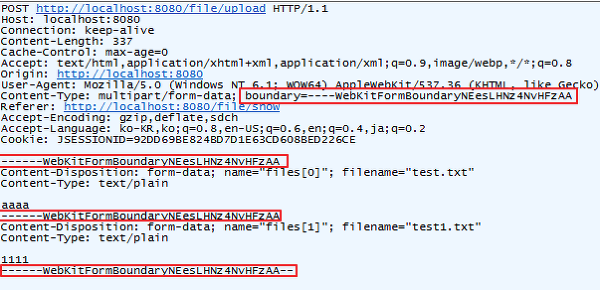

# MultipartFile — 파일 업로드 처리

> 최종 업데이트: 2026-06-23 | Spring (`org.springframework.web.multipart`) 기준

## 개념

**`MultipartFile`** 은 Spring이 **업로드된 파일 하나를 다루기 위해 제공하는 인터페이스**다. 클라이언트가 `multipart/form-data` 요청으로 올린 파일을, 자바 코드에서 손쉽게 꺼내 쓰도록 감싼 손잡이다.

> 비유: 택배 상자 하나(HTTP 요청)에 칸막이로 물건들(폼 필드 + 파일)을 나눠 담아 보낸다. `MultipartFile`은 그중 **파일 한 칸을 꺼내 다루는 손잡이**다. 단 그 손잡이는 접수창구에 잠깐 놓인 상태라, 안 챙기면(저장 안 하면) 치워진다.

## multipart/form-data — 파일이 실려오는 방식

`MultipartFile`을 이해하려면 파일이 **어떻게 실려오는지**부터 알아야 한다.

일반적으로 HTTP Request Body의 Content-Type은 하나만 지정한다. 그런데 파일 업로드는 **바이너리(첨부파일)와 문자(설명·제목)를 동시에** 보내야 해서 타입이 충돌한다. 이를 해결하려고 나온 게 `multipart/form-data`다 — **하나의 본문을 `boundary`(칸막이)로 여러 파트로 나눠** 서로 다른 종류의 데이터를 한 번에 싣는다.

### form 태그와 enctype

HTML 폼에서 전송 방식을 정하는 속성들이다.

| 속성 | 역할 |
|------|------|
| `name` | 서버로 보낼 때의 데이터 이름(키) |
| `action` | 폼이 전송되는 서버 URL |
| `method` | 전송 방법 (`get` / `post`) |
| `enctype` | 데이터가 인코딩되는 방식 |

`enctype` 값에 따라 인코딩이 달라진다.

| enctype | 의미 |
|---------|------|
| `application/x-www-form-urlencoded` | 기본값. 모든 문자를 인코딩해 `username=kim&age=30` 형태로 Body에 실음 |
| `text/plain` | 공백을 `+`로 바꾸고 나머지는 인코딩하지 않음 |
| **`multipart/form-data`** | 문자를 인코딩하지 않고 파트로 나눠 전송. **파일·이미지가 있을 때 사용** |

```html
<form th:action="@{/api/upload}" method="post" enctype="multipart/form-data">
    제목 : <input type="text" name="title"> <br>
    파일 : <input type="file" name="file"> <br>
    <button>등록하기</button>
</form>
```

### boundary — 파트를 구분하는 칸막이



요청 헤더의 Content-Type이 `multipart/form-data`이면, 전송 항목을 구분할 **`boundary`가 무작위 문자열로 정해진다**. 본문은 이 boundary로 각 파트(파일·필드)를 나누고, 마지막 boundary에는 끝임을 알리는 `--`가 붙는다.

```
Content-Type: multipart/form-data; boundary=----X
------X
Content-Disposition: form-data; name="title"               ← 일반 필드 파트
공지사항
------X
Content-Disposition: form-data; name="file"; filename="cat.png"   ← 파일 파트
(바이너리 데이터...)
------X--                                                   ← 끝(-- 붙음)
```

이 중 **파일 파트 하나**를 Spring이 `MultipartFile` 객체로 만들어 준다.

## MultipartFile 인터페이스 — Spring에서 받기

컨트롤러에서 `@RequestParam`으로 받는다. 폼의 `name`과 파라미터 이름을 맞춘다.

```java
@PostMapping("/api/upload")
public String upload(@RequestParam("title") String title,
                     @RequestParam("file") MultipartFile file) {
    String name = file.getOriginalFilename();   // "cat.png"
    long   size = file.getSize();                // 바이트 크기
    // ... 저장 처리
    return "ok";
}
```

여러 파일은 `List<MultipartFile>` 또는 `MultipartFile[]`로, 객체 바인딩이 필요하면 `@ModelAttribute` DTO의 필드로 받는다.

### 주요 메서드

| 메서드 | 역할 |
|--------|------|
| `getOriginalFilename()` | 업로드된 원본 파일명 |
| `getContentType()` | MIME 타입 (`image/png` 등) |
| `getSize()` | 파일 크기(바이트) |
| `getBytes()` | 내용을 `byte[]`로 (작은 파일) |
| `getInputStream()` | 내용을 스트림으로 (대용량) |
| `transferTo(dest)` | 파일·경로로 **저장** |
| `isEmpty()` | 빈 파일 여부 |

## 저장 — 휘발되니 옮겨야 한다

`MultipartFile`이 들고 있는 데이터는 **메모리나 임시 디렉터리에 잠깐** 보관된다. **요청 처리가 끝나면 사라지므로**, 영구 보관하려면 요청 안에서 `transferTo()`로 옮기거나 스트림을 읽어 저장해야 한다.

```java
file.transferTo(new File("/data/uploads/" + file.getOriginalFilename()));
// 또는 스트림으로 (대용량·클라우드 업로드)
try (InputStream in = file.getInputStream()) { /* S3 등으로 전송 */ }
```

원본 파일명을 그대로 경로에 쓰면 **경로 조작(`../`)·중복·한글 깨짐** 위험이 있으니, 보통 UUID 등으로 새 이름을 만들어 저장한다.

## 업로드 설정

크기 제한은 프로퍼티로 건다. 초과하면 `MaxUploadSizeExceededException`이 난다.

```properties
spring.servlet.multipart.max-file-size=10MB      # 파일 하나 최대
spring.servlet.multipart.max-request-size=20MB   # 요청 전체 최대
```

내부적으로는 `MultipartResolver`가 요청을 파싱해 `MultipartFile`로 만든다. Spring Boot는 이를 자동 구성하므로 별도 등록은 보통 불필요하다.

## 관련 문서

- [HTTP](../CS-이론/네트워크/통신-프로토콜/HTTP/HTTP.md) — `multipart/form-data`가 실리는 프로토콜
- [Java IO 기본](Java-Input-Output/Java-IO/Java-IO-basic.md) — `getInputStream`/`transferTo`의 스트림 처리

## 출처

- [스프링 부트 파일 업로드/다운로드/이미지 보여주기 (velog)](https://velog.io/@gmtmoney2357/%EC%8A%A4%ED%94%84%EB%A7%81-%EB%B6%80%ED%8A%B8-%ED%8C%8C%EC%9D%BC-%EC%97%85%EB%A1%9C%EB%93%9C-%EB%8B%A4%EC%9A%B4%EB%A1%9C%EB%93%9C-%EC%9D%B4%EB%AF%B8%EC%A7%80-%EB%B3%B4%EC%97%AC%EC%A3%BC%EA%B8%B0)
- [HTTP multipart/form-data (lena-chamna)](https://lena-chamna.netlify.app/post/http_multipart_form-data/)
