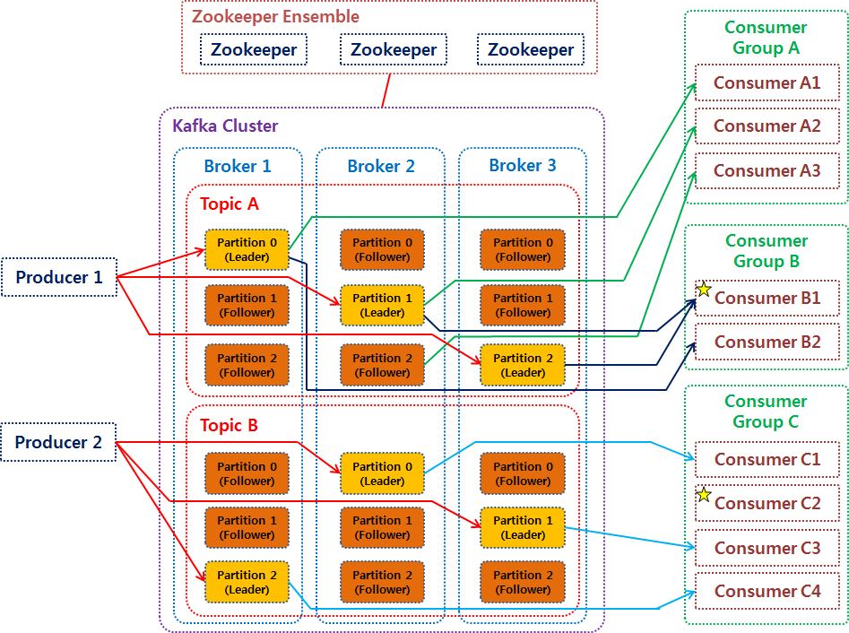
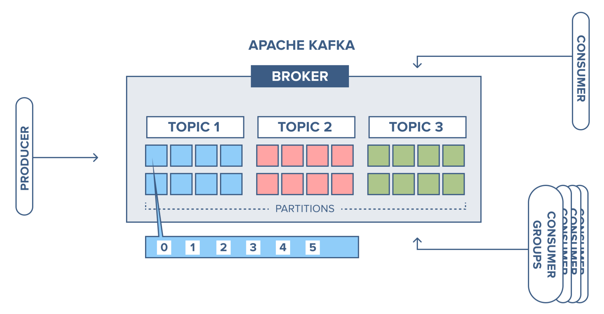
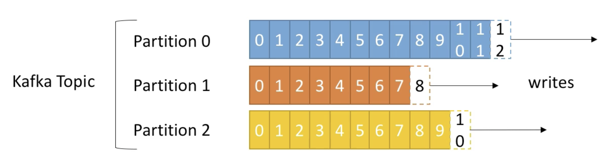
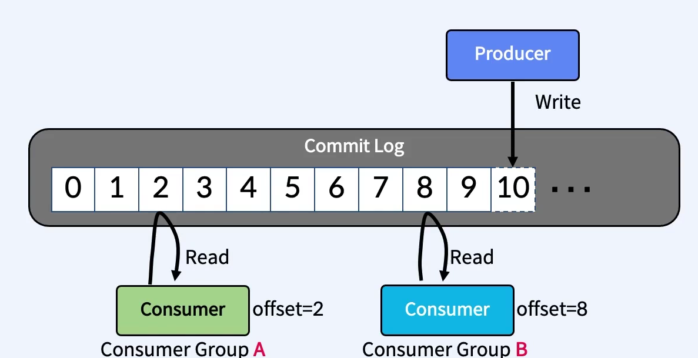
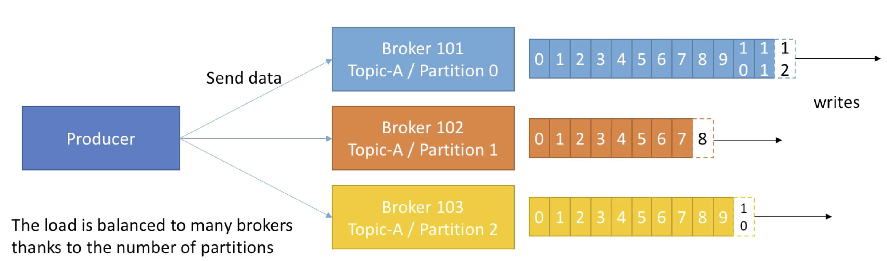
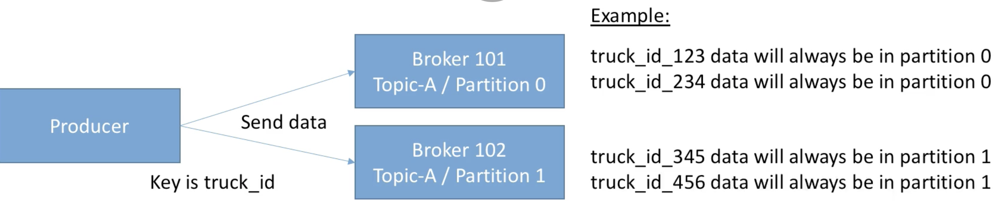
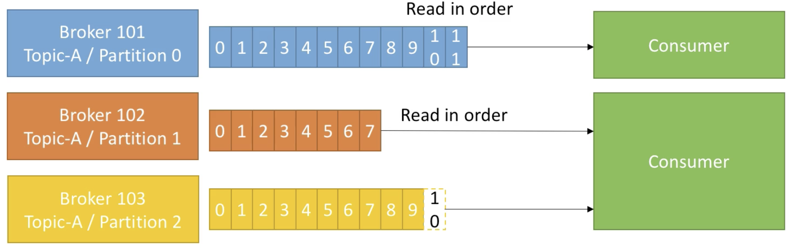
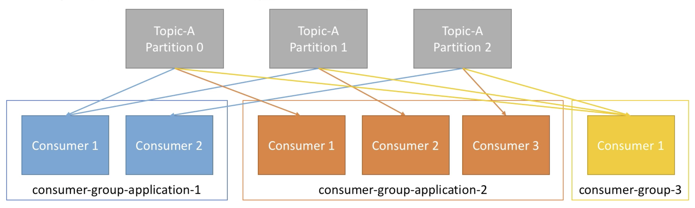

# Apache Kafka

## 카프카 아키텍처



## 아파치 카프카는 무엇인가?
- Data in Motion Platform
  - 움직이는 데이터를 처리하는 플랫폼
- Real-time Event Streams을 받아서 Real-time Event Streams이 필요로 하는 곳으로 보낸다.
- LinkedIn에서 개발
  - 하루 4.5조개 event stream 처리
- 프란츠 카프카에서 이름을 따옴
  - 디스크에 write하는 카프카와 writer 카프카
- confluent
  - kafka 창시자 jay kreps가 창업한 회사

### Event란?
- 비즈니스에서 일어나는 모든 일(데이터) 혹은 메시지
- BigData라는 특징
  - 비즈니스 모든 영역에서 광범위하게 발생
- Event Stream
  - 연속적인 많은 이벤트가 흐름처럼 온다는 의미

## 특징
- 이벤트 스트림을 안전하게 전송. publish & subscribe
- 발행자와 구독자가 서로 의존성이 줄어듬. kafka에만 연결하면 되도록 변함.
- event stream을 디스크에 저장 (기존과 가장 크게 다른 특징)
- event stream을 분석 및 처리

## 사용 사례
- messaging system
- iot 디바이스 수집
- 애플리케이션 로그 수집
- 이상감지
- MSA 기반의 분리된 DB간 동기화
- 실시간 ETL
- spark, hadoop 빅데이터 

## 기존 메시징 시스템과 다른 점

1. 디스크에 메시지 저장
    1. 기존 메시징 시스템은 컨슈머가 메시지를 소비하면 큐에서 바로 삭제했음
    2. 디스크에 메시지를 일정기간 보관하기 때문에 메시지의 손실이 없음
2. 멀티 프로듀서, 멀티 컨슈머
    1. 프로듀서와 컨슈머 모두 하나 이상의 메시지를 주고 받을 수 있음
3. 분산형 스트리밍 플랫폼
    1. 단일 시스템 대비 성능 우수.
    2. 시스템 확장 용이
4. 페이지 캐시
    1. 잔여 메모리를 이용하지 않고, 페이지 캐시를 통한 Read/Write를 함
5. 배치 전송 처리
    1. 메세지를 작은 단위로 묶어 배치 처리를 해서 속도 향상을 시킴

## 카프카 구성요소



## 구성요소별 개념
| 구성요소 | 역할 | 실제 실행 위치 | 버전 의미 | 
|--|--|--|--|
|Broker (Server) | 메시지를 저장하고 클라이언트 요청을 처리하는 서버 프로세스 | Kafka 서버(컨테이너, EC2 등) | 흔히 말하는 “Kafka 버전” = Broker 버전
|Client (Producer / Consumer) | 메시지를 보내거나 받는 애플리케이션 측 라이브러리 | Spring Boot, Python, Node 등 애플리케이션 | kafka-clients 라이브러리 버전
| Streams (Kafka Streams API) | 스트림 처리용 Java 라이브러리 (window, join 등) | 애플리케이션 내부 | kafka-streams 라이브러리 버전
| Connect (Kafka Connect) | 외부 시스템(DB, Elasticsearch 등)과 데이터를 연동하는 런타임 | 별도 JVM 프로세스 (plugin 기반) | Broker와 동일 버전으로 빌드되는 서버

## Kafka 구동 순서
- Controller 1, 2, 3
  - Raft 합의 그룹을 먼저 형성 (Leader Controller 선출)
- Leader Controller
  - 클러스터 메타데이터 로그 초기화
- Broker 1, 2, 3
  - 컨트롤러에 조인 요청을 보내고, 클러스터 메타데이터를 가져옴
  - 브로커는 부팅할 때 반드시 컨트롤러에게 이렇게 물어봄.
    - “이 클러스터의 메타데이터 로그는 어디 있나요? 제 Node ID가 유효한가요? Partition/Topic 정보를 받아올 수 있나요?”
  - 이때 컨트롤러들이 아직 준비되지 않았다면, 브로커는 다음 오류를 내고 부팅에 실패
      ```
      org.apache.kafka.common.errors.DisconnectException:
      Failed to connect to controller quorum: connection refused
      ```
- 클러스터 정상화
  - Broker들이 데이터를 주고받기 시작

## 클러스터
- Kafka 용어에서 클러스터(cluster) 는 다음 구성 요소 전체를 의미
  - 하나 이상의 Kafka Broker (데이터 저장, 메시징)
  - 하나의 KRaft Controller Quorum (메타데이터 합의)
  - 이들이 같은 CLUSTER_ID를 공유할 때 → 하나의 Kafka 클러스터
- 내부적으로 “KRaft 메타데이터 로그(__cluster_metadata)”를 관리
  - 이때 CLUSTER_ID는 식별자 역할로 Kafka 클러스터가 어느 메타데이터 로그를 사용하는지 구분

## KRaft Controller

- Kafka 4.x 버전부터 Zookeeper를 완전히 대체하는 독립된 Raft 기반 메타데이터 관리 노드 그룹
- KRaft Controller Quorum이 메타데이터 합의를 수행하여 클러스터의 상태를 일관되게 유지
- `controller.quorum.voters` 설정으로 합의 그룹(보통 3대 이상의 홀수)을 명시
- 하나의 컨트롤러는 Leader Controller 역할을 수행하고, 나머지는 Follower Controller 역할을 수행
- 운영 예시
  - 단일 노드/개발용: broker,controller 겸임(한 프로세스에서 두 역할 모두 수행)
  - 운영/다중 노드: 컨트롤러 전용 노드(controller-only)와 브로커 전용 노드(broker-only)를 분리해 고가용성 구성 가능(일반적으로 컨트롤러 3~5대의 홀수 Quorum)
    - 3대 이상 구성하여 Raft 합의 과반수를 확보하는 것을 권장
- 컨트롤러의 주요 역할:
  - 클러스터 메타데이터 관리 (토픽, 파티션, 복제 등)
  - 리더 선출 (Leader Election)
  - 브로커 등록 및 제거 관리
  - 클러스터 메타데이터 변경 사항을 모든 브로커에 전파

## 브로커(Broker)



- Kafka Cluster는 여러대의 Broker로 구성
- `Kafka Server`라고도 불림. 
- Topic 내의 Partition들을 분산배치, 유지, 관리하는 역할
- 각 broker는 고유한 id(숫자)로 식별됨.
- 특정 topic의 partition들을 가지고 있다.
- Broker ID와 Partition ID는 관계가 없음.
- 동일한 Topic의 Partition들은 여러 Broker에 분산돼서 배치된다.
- Client(producer, consumer)는 특정 Broker에만 연결하면 전체 Cluster에 연결가능함.
  1. Client는 **Bootstrap Server** 라는 파라미터를 가지고 접속함.
    - kafka cluster 내의 전체 Broker를 부르는 말
  2. 하나의 Broker에 연결을 하면
  3. 이 Broker는 Cluster 내의 전체 Broker의 리스트를 전달해줌
  4. Client는 topic의 Partition들이 어느 Broker에 있는지 알게돼서 그 Broker들에 접속하게 됨.
  5. 그런데 일반적으로 최초 접속하려는 Broker가 죽어버리면 접속할 수 없어져서 그냥 전체 Broker를 ,로 구분해서 다 집어넣음
- **최소 3대 이상**의 Broker로 하나의 Cluster를 구성해야 하며 안정성을 위해 `4대` **이상을 권장**한다.
  - 최소 3대 브로커 + replication.factor=3 구성을 권장
  - 

## 토픽과 파티션

토픽(메시지 분류의 논리적 단위)과 파티션(물리적 분할·병렬 처리·비용 단위), 그리고 복제·오프셋·내부 토픽은 분량이 커서 **별도 문서로 분리**했다.

→ **[Kafka-Topic.md](Kafka-Topic.md)** 에서 다룬다.

- **토픽**: 메시지가 분류되어 저장되는 논리적 단위. 여러 파티션의 집합이며, 생성 시 파티션 개수를 지정한다.
- **파티션**: 토픽을 물리적으로 쪼갠 단위. 병렬 처리 성능의 단위인 동시에 자원(파일 핸들·메모리·복제 트래픽)을 먹는 **비용 단위**라, 무작정 늘릴 수 없다(한번 늘리면 줄일 수도 없다).
- **복제(Replication Factor)·오프셋(Offset)·내부 토픽**(`__consumer_offsets`, `__transaction_state`)도 같은 문서에서 다룬다.

## Producer와 Consumer


- `producer`와 `consumer`는 서로를 모름
- 각각 고유의 속도로 `Commit Log`에 write하고 read한다

## 프로듀서(Producers)



- 메시지를 생산(Produce)해서 브로커의 Topic으로 메시지를 보내는 애플리케이션
- 데이터를 쓰는 동시에 어떤 broker의 어떤 파티션으로 가게 될지 알고있음.


### 메세지 키(message keys)



프로듀서가 데이터를 writer 할 때, 

key값을 설정해서 보낼 수 있음.

key = null이면, 메시지는 UniformStickyPartitioner 방식으로 데이터가 배치로 모두 묶일 떄까지 기다린 뒤, 덩어리는 모두 동일한 파티션에 전송됨.

key를 지정하면, 항상 같은 파티션으로 보내짐.

## 컨슈머(consumers)


- Topic 파티션에 저장되어 있는 메시지를 소비(Consume)하는 애플리케이션
- 서로 다른 그룹의 Consumer들은 서로 관련이 없다
각 파티션 내에서 순서대로 읽어옴.

## 컨슈머 그룹



- Consumer들의 집합
- 카프카는 컨슈머를 그룹 단위로 관리
- 동일 토픽에 대해 여러 컨슈머가 분산 병렬 처리
- 프로듀서가 메시지를 전달하는 속도가 컨슈머가 메시를 가져가는 속도 보다 빠를 때, 메시지가 점점 쌓이기 떄문에 
- 하나의 파티션당 하나의 컨슈머가 연결. 그룹 내의 컨슈머는 각기 다른 파티션에 할당.
- 컨슈머의 수가 파티션의 수보다 많다면, 몇 컨슈머는 놀게 됨

## 참조

https://velog.io/@jaehyeong/Apache-Kafka%EC%95%84%ED%8C%8C%EC%B9%98-%EC%B9%B4%ED%94%84%EC%B9%B4%EB%9E%80-%EB%AC%B4%EC%97%87%EC%9D%B8%EA%B0%80

https://velog.io/@king3456/Apache-Kafka-%EA%B8%B0%EB%B3%B8%EA%B0%9C%EB%85%90

https://velog.io/@jwpark06/Kafka-%EC%8B%9C%EC%8A%A4%ED%85%9C-%EA%B5%AC%EC%A1%B0-%EC%95%8C%EC%95%84%EB%B3%B4%EA%B8%B0