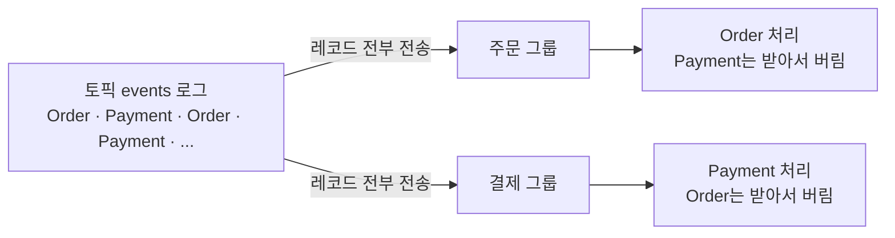

# Kafka Consumer (일반론)

> 최종 업데이트: 2026-06-10 | Apache Kafka 4.x 기준

특정 프레임워크와 무관한 **Kafka 컨슈머 자체의 동작 원리**를 다룬다. 토픽/파티션/오프셋의 기본 정의는 [Kafka-Topic.md](Kafka-Topic.md), Spring에서의 사용법은 [Spring-Kafka-Consumer.md](Spring-Kafka-Consumer.md)를 참고한다.

## 개념

**컨슈머(Consumer)** 는 토픽의 파티션에서 메시지를 **직접 가져와(pull)** 읽는 주체다. 브로커가 컨슈머에게 메시지를 밀어주는(push) 게 아니라, **컨슈머가 자기 속도에 맞춰 브로커에 요청해서 끌어온다**. 이것이 Kafka 컨슈머를 이해하는 출발점이다.

> 비유: 뷔페와 같다. 종업원이 음식을 자리로 가져다주는(push) 게 아니라, 손님(컨슈머)이 접시를 들고 가서 **자기가 먹을 만큼 직접 담아온다(pull)**. 느리게 먹는 손님도 자기 페이스대로 가져가므로 체할 일이 없다.

컨슈머는 항상 **컨슈머 그룹** 단위로 동작하며, 어디까지 읽었는지를 **오프셋(offset)**으로 추적한다.

## 비파괴적 소비 — 읽어도 사라지지 않는다

Kafka 컨슈머를 가장 헷갈리게 하는 지점이다. **컨슈머가 메시지를 읽어도 토픽에서 사라지지 않는다.** 기존 메시지 큐(읽으면 빠지는)와 가장 다른 부분이다.

토픽은 **큐가 아니라 로그(append-only)**다. 각 레코드는 딱 한 번 저장돼 retention 기간 동안 그대로 남고, 컨슈머가 "읽는다"는 건 그 로그를 자기 **오프셋 위치에서 훑는 것**일 뿐 꺼내가는 게 아니다.

> 비유: 큐는 **택배 보관함**이다. 물건을 꺼내면 칸이 빈다. 로그는 **도서관 책**이다. 읽어도 페이지가 찢겨 나가지 않고 다음 사람도 같은 책을 읽으며, 내가 어디까지 읽었는지는 내 **책갈피(오프셋)**가 기억한다.

| 구분 | 큐 (RabbitMQ 등) | 로그 (Kafka) |
|------|------------------|--------------|
| 읽으면? | 메시지가 큐에서 제거됨 | 그대로 남음 |
| 삭제 시점 | 소비 즉시 | retention 만료 시에만 (기본 7일) |
| 재처리(replay) | 불가 (이미 사라짐) | 오프셋 되감으면 다시 읽음 |
| 다른 컨슈머도 읽기 | 한 번 소비되면 끝 | 그룹마다 독립적으로 전부 읽음 |

레코드가 토픽에서 실제로 사라지는 건 오직 **retention 만료**(`cleanup.policy=delete` + 보존시간 경과) 때뿐이다. 컨슈머가 무엇을 하든 — 읽든, 건너뛰든, 버리든 — 토픽의 데이터에는 영향을 주지 않는다.

## Pull 모델 — 왜 컨슈머가 가져가나

메시징 시스템의 전달 방식은 크게 둘이다.

| 방식 | 주체 | 대표 |
|------|------|------|
| **Push** | 브로커가 컨슈머에게 밀어줌 | RabbitMQ(기본), Redis Pub/Sub, 웹훅 |
| **Pull** | 컨슈머가 브로커에서 끌어옴 | **Kafka**, AWS SQS |

Kafka가 Pull을 택한 것은 의도된 설계다.

| 이유 | 설명 |
|------|------|
| **백프레셔(소화 속도 제어)** | 컨슈머가 자기 처리 속도대로 가져간다. Push면 느린 컨슈머가 밀려드는 메시지에 압사한다. |
| **배치 효율** | 컨슈머가 한 번에 N건씩 모아서 가져갈 수 있다. |
| **오프셋 되감기(replay)** | 컨슈머가 오프셋을 직접 지정해 과거 메시지를 재처리할 수 있다. |
| **브로커 단순화** | 브로커가 "누구에게 어디까지 줬나"를 추적·관리할 필요가 없다. 읽은 위치는 컨슈머(그룹)가 관리한다. |

특히 백프레셔가 핵심이다. Push 방식은 컨슈머가 버거워도 브로커가 계속 밀어넣어 터질 수 있지만, Pull은 "내가 준비됐을 때만 가져가"가 되어 안정적이다.

## poll과 Long Polling

Pull이라고 해서 옛날 DB 폴링처럼 "데이터 없어도 주기마다 헛질의"하는 건 아니다. Kafka는 **Long Polling**으로 효율을 확보한다.

```
컨슈머: poll() → "메시지 줘"
브로커: 줄 게 없으면 → 바로 빈손 응답 ❌
        대신 fetch.max.wait.ms 동안 기다림 ⏳
              그 사이 메시지 도착 → 즉시 응답 ✅
              끝까지 안 오면 → 타임아웃으로 빈손 응답
```

`poll()`은 컨슈머가 브로커에서 레코드를 가져오는 함수다. 데이터가 없을 때 브로커가 요청을 잠깐 들고 기다려주므로, 형식은 Pull이지만 지연은 Push에 가깝다.

이 동작을 제어하는 설정:

| 설정 | 위치 | 의미 |
|------|------|------|
| `fetch.min.bytes` | 브로커 대기 | 이만큼 쌓일 때까지 기다렸다 응답 (기본 1byte → 즉시) |
| `fetch.max.wait.ms` | 브로커 대기 | 최대 이만큼만 기다림 (기본 500ms) |
| `max.poll.records` | 컨슈머 | poll() 한 번이 반환하는 최대 레코드 수 (기본 500) |

`fetch.min.bytes`를 키우면 "좀 모아서 한 번에" 주므로 처리량↑·지연↑ 트레이드오프가 된다.

> HTTP 클라이언트-서버 맥락의 Long Polling(채팅·알림)은 [Polling과 Long Polling.md](../CS-이론/네트워크/통신-프로토콜/HTTP/통신-기법/Polling과-Long-Polling.md)에서 별도로 다룬다. 개념은 같지만 적용 계층이 다르다.

## 컨슈머 그룹과 파티션 할당

컨슈머는 **컨슈머 그룹** 단위로 파티션을 나눠 병렬 처리한다.

- **한 파티션은 그룹 내 한 컨슈머에만** 할당된다(순서 보장의 단위).
- 그룹 내 컨슈머 수를 늘리면 파티션이 분배되어 처리량이 는다(수평 확장).
- **컨슈머 수 > 파티션 수**면 남는 컨슈머는 논다(파티션을 못 받음). 그래서 파티션 수가 병렬성의 상한이다.
- 서로 **다른 그룹**은 같은 메시지를 각자 독립적으로 받는다(브로드캐스트 효과).

```
토픽: 파티션 0,1,2,3 (4개)

그룹 A (컨슈머 3개): C1→[P0,P1]  C2→[P2]  C3→[P3]
그룹 B (컨슈머 1개): C1→[P0,P1,P2,P3]   ← A와 무관하게 전부 받음
```

## 한 토픽을 여러 그룹이 읽을 때 — 필터링과 그 비용

서로 다른 컨슈머 그룹은 **각자 독립된 오프셋**으로 같은 로그를 읽는다(앞의 브로드캐스트 효과). 그룹 A가 어디까지 읽었든 그룹 B에는 영향이 없다. 그런데 **한 토픽에 여러 종류의 메시지가 섞여 있을 때** 미묘한 비용이 생긴다.

핵심은 Kafka가 **내용을 보고 골라주지 않는다**는 점이다. 컨슈머가 "나는 주문 이벤트만 줘"라고 요청할 수 없다. 브로커는 파티션에 쌓인 레코드를 **순서대로 전부** 넘기고, 어떤 걸 처리할지는 컨슈머(앱 코드)가 정한다.

예를 들어 한 토픽 `events`에 `OrderCreated`와 `PaymentCompleted`가 섞여 발행되고, 주문 그룹은 주문만·결제 그룹은 결제만 처리한다고 하자.



주문 그룹은 `PaymentCompleted`를 받긴 받지만, **fetch + 역직렬화까지 다 한 뒤** 자기 것이 아니라서 버린다(애플리케이션 레벨 필터). 받기 전엔 그게 주문인지 결제인지 모르므로, 일단 까봐야(역직렬화) 안다.

이때 "버린다"가 무슨 뜻인지가 핵심이다 — 흔히 셋과 헷갈린다.

| 오해 | 실제 |
|------|------|
| 토픽에서 삭제된다? | ❌ 그대로 남는다. retention 만료로만 삭제 |
| 메시지가 유실된다? | ❌ 결제 그룹이 자기 오프셋으로 정상 처리한다 |
| 다시 토픽에 넣는다(재투입)? | ❌ 애초에 빠진 적이 없으니 넣을 것도 없다 |
| 그럼 뭔가? | ✅ 내 그룹의 오프셋만 그 레코드를 **지나쳐 전진**할 뿐 |

대신 같은 레코드를 그룹마다 한 번씩 읽으므로 **읽기 비용이 중복**된다. 그룹이 N개면:

| 항목 | 비용 | 설명 |
|------|------|------|
| 디스크 저장 | ×1 | 로그는 한 벌. 그룹 수와 무관 |
| 브로커→컨슈머 전송 | ×N | 그룹마다 한 번씩 네트워크 전송 |
| 역직렬화(CPU) | ×N | 그룹마다 받아서 각자 해석 |

저장이 늘거나 데이터가 떠도는 게 아니라 **읽기·역직렬화가 그룹 수만큼 중복**되는 것이다. 유실·중복발송 같은 안전성 문제는 없고 순수 효율 이슈다. 종류별 트래픽이 많아 이 중복이 부담되면 토픽을 종류별로 분리하는 설계를 검토한다. 구현 측면에서 Spring Kafka는 `RecordFilterStrategy`로 걸러내며, `setAckDiscarded(true)`를 주면 걸러낸 레코드의 오프셋을 자동 커밋해 재처리하지 않는다([Spring-Kafka-Consumer.md](Spring-Kafka-Consumer.md)).

## 리밸런싱과 파티션 할당 전략

**리밸런싱(rebalancing)** 은 그룹에 컨슈머가 추가/제거되거나 파티션 수가 바뀔 때, 파티션을 멤버에게 다시 분배하는 과정이다. 누가 어떤 파티션을 맡을지 정하는 규칙이 **파티션 할당 전략**이다.

| 방식 | 대표 전략 | 리밸런싱 동작 |
|------|----------|--------------|
| **Eager** (구 기본) | `RangeAssignor`, `RoundRobinAssignor` | 모든 컨슈머가 **파티션을 전부 반납**하고 멈춘 뒤 재분배 (stop-the-world) |
| **Cooperative** (권장) | `CooperativeStickyAssignor` | 옮길 파티션만 반납. **영향 없는 컨슈머는 계속 처리** |

Eager는 컨슈머 한 대만 추가돼도 그룹 전체가 잠깐 멈춘다. 파티션·컨슈머가 많을수록 멈춤 시간이 길어진다. `CooperativeStickyAssignor`는 재배치가 필요한 파티션만 점진적으로 옮겨 무중단에 가깝게 동작하므로, 배포·오토스케일이 잦은 환경에서 권장된다. "Sticky"는 기존 할당을 최대한 유지해 불필요한 이동을 줄인다는 의미다.

리밸런싱이 잦으면 그때마다 처리가 끊기므로, `session.timeout.ms`·`max.poll.interval.ms`를 적절히 잡아 불필요한 리밸런싱(컨슈머가 죽은 것으로 오인되는 것)을 피하는 것도 중요하다.

## 오프셋과 커밋

오프셋은 파티션 안에서 메시지의 순번이다. 컨슈머 그룹은 "여기까지 읽었다"를 **커밋**해 `__consumer_offsets` 내부 토픽에 기록한다.

- **LOG-END-OFFSET**: 파티션에 쓰인 마지막 메시지 위치 (프로듀서가 쓴 끝)
- **CURRENT-OFFSET**: 컨슈머 그룹이 읽고 커밋한 위치
- 커밋을 언제 하느냐가 **중복/유실**을 가른다.

| 커밋 방식 | 동작 | 리스크 |
|----------|------|--------|
| 자동 커밋 (`enable.auto.commit=true`) | 일정 주기로 자동 커밋 | 처리 전에 커밋되면 장애 시 **유실**, 처리 후 못 커밋하면 **중복** |
| 수동 커밋 | 처리 성공 후 직접 커밋 | 제어 정확, 코드 책임 증가 |

## 전달 의미론 (Delivery Semantics)

커밋 시점과 처리 순서의 조합으로 세 가지 보장이 나온다.

| 의미론 | 보장 | 구현 |
|--------|------|------|
| **At-most-once** | 최대 한 번 (유실 가능, 중복 없음) | 처리 **전에** 오프셋 커밋 |
| **At-least-once** | 최소 한 번 (중복 가능, 유실 없음) | 처리 **후에** 오프셋 커밋 — 가장 일반적 |
| **Exactly-once** | 정확히 한 번 | 트랜잭션 + idempotent producer, 또는 Kafka Streams EOS |

대부분의 시스템은 **at-least-once**를 택하고, 컨슈머 로직을 **멱등(idempotent)**하게 만들어 중복을 흡수한다. 같은 메시지를 두 번 처리해도 결과가 같도록 설계하는 것이다.

## 컨슈머 Lag

**Lag**은 `LOG-END-OFFSET − CURRENT-OFFSET`, 즉 **아직 처리 못 한 메시지 수**다. 컨슈머 처리 속도가 프로듀서 생산 속도를 못 따라가면 lag이 쌓인다.

- lag이 계속 증가 → 컨슈머 처리량 부족. 컨슈머 추가(파티션 수 이내) 또는 처리 로직 최적화 필요.
- **특정 파티션만** lag이 급증 → 그 파티션에 [poison pill](Spring-Kafka-Consumer.md#1단계-방어--역직렬화-errorhandlingdeserializer)이 끼어 멈췄을 가능성.
- 진단: `kafka-consumer-groups.sh --describe --group <그룹명>`으로 파티션별 lag 확인.

## 관련 문서

- [Kafka-Topic.md](Kafka-Topic.md) — 토픽/파티션/오프셋/복제/내부 토픽 정의
- [1)-Kafka-개념.md](1\)-Kafka-개념.md) — 클러스터/브로커/컨트롤러, 컨슈머 그룹 등 전반
- [Kafka-파티션-컨슈머-스케일링.md](Kafka-파티션-컨슈머-스케일링.md) — 컨슈머 수를 정적/동적으로 다루는 전략, KEDA 오토스케일링
- [Spring-Kafka-Consumer.md](Spring-Kafka-Consumer.md) — Spring에서의 컨슈머 구현 (@KafkaListener, 컨테이너, 에러 처리)
- [5)-Kafka-명령어.md](5\)-Kafka-명령어.md) — `kafka-consumer-groups.sh` 등 CLI
- [데이터-전송-및-상호작용-방식.md](../CS-이론/네트워크/데이터-전송-및-상호작용-방식.md) — Push/Pull/Polling을 포함한 통신 방식 전반
- [Polling과 Long Polling.md](../CS-이론/네트워크/통신-프로토콜/HTTP/통신-기법/Polling과-Long-Polling.md) — HTTP 맥락의 Long Polling

## 출처

- [Kafka Documentation — Consumer](https://kafka.apache.org/documentation/#theconsumer)
- [Kafka Consumer Configs](https://kafka.apache.org/documentation/#consumerconfigs)
- [KIP-429: Cooperative Rebalancing](https://cwiki.apache.org/confluence/display/KAFKA/KIP-429)
