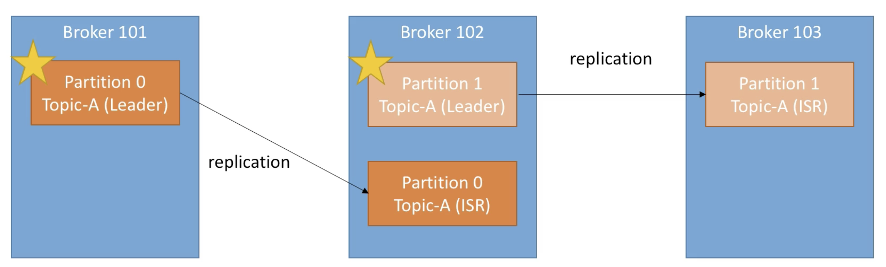
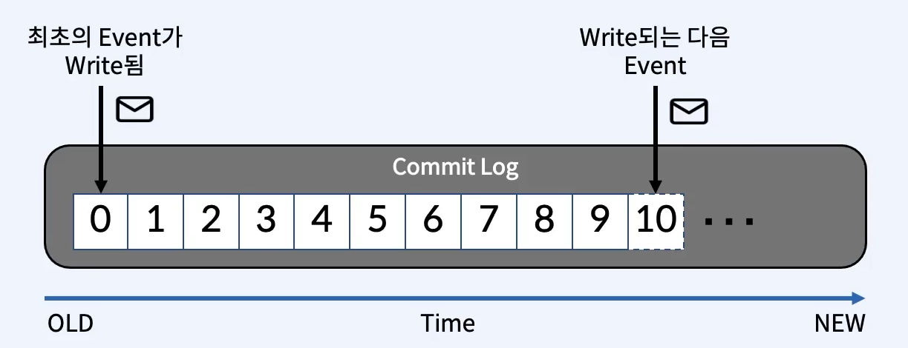
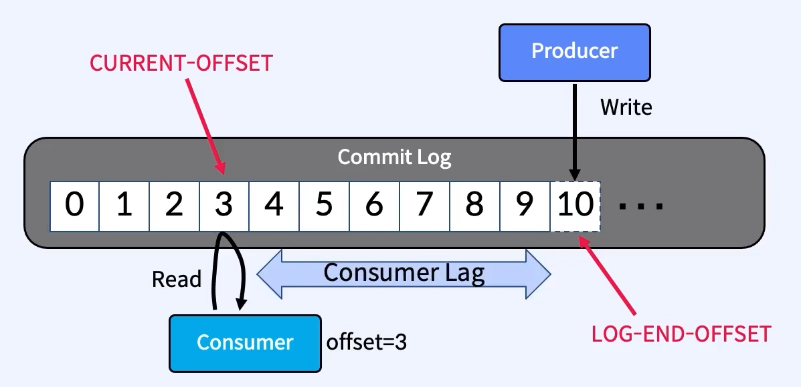

# Kafka 토픽과 파티션

> 최종 업데이트: 2026-06-24 | Apache Kafka 4.x (KRaft) 기준

Kafka에서 데이터가 담기는 단위인 **토픽(Topic)**과, 그 물리적 분할 단위인 **파티션(Partition)**, 그리고 이와 직결된 복제·오프셋·내부 토픽을 다룬다. 클러스터·브로커 등 상위 구조는 [1)-Kafka-개념.md](1\)-Kafka-개념.md), 컨슈머의 읽기 동작은 [Kafka-Consumer.md](Kafka-Consumer.md)를 참고한다.

## 개념

**토픽**은 메시지가 분류되어 저장되는 **논리적 단위**다. 눈에 보이는 물리적 공간이 아니라, 브로커가 데이터를 관리할 때 기준이 되는 이름표다. 데이터베이스의 "테이블"에 가깝다 — 같은 종류의 이벤트를 한 토픽에 모은다.

> 비유: 토픽은 **우체국의 사서함 종류**다. "주문함", "결제함"처럼 이름으로 구분되고, 실제 편지(메시지)는 그 안의 여러 칸(파티션)에 나뉘어 쌓인다.

- 토픽 이름으로 구분되므로 **네이밍 규칙**을 정해두면 의미를 유추하기 쉽다.
- 하나의 토픽은 **여러 파티션의 집합**이다. 생성 시 파티션 개수를 지정한다(복제 계수와는 별개의 개념).
- 파티션 수가 곧 **병렬 처리 성능**이다. 단, **운영 도중 변경은 권장하지 않는다**(뒤의 비용 섹션 참조).

## 파티션 — 토픽의 물리적 분할

**파티션**은 토픽을 **물리적으로** 쪼갠 단위다. 토픽이 논리적 이름표라면, 실제 데이터는 파티션에 저장된다. Kafka는 OS 파일시스템을 그대로 저장소로 활용한다.

> 비유: 토픽이 "주문함"이라는 사서함 종류라면, 파티션은 그 안의 **실제 우편함 칸 0·1·2**다. 편지가 많으면 칸을 늘려 여러 집배원(컨슈머)이 동시에 처리한다.

- 하나의 파티션 = 하나의 **Commit Log**로 동작한다(아래 참조).
- 하나의 파티션은 여러 **세그먼트(Segment)** 파일로 구성된다.
  - 실제 데이터가 저장되는 물리 파일. 항상 끝에 append 된다.
  - 용량(기본 1GB) 또는 시간(기본 168시간) 기준으로 **롤링**되어 새 파일이 열린다.
  - 과거 세그먼트에는 더 이상 쓰지 않는다.
- 같은 토픽의 파티션이라도 **서로 다른 브로커에 분산 배치**된다(컨트롤러가 균형 배치). 번호는 0부터 오름차순.
- **같은 파티션 안에서만 메시지 순서가 보장**된다. 파티션이 다르면 서로 순서 관계가 없다.
- 한번 저장된 데이터는 변경 불가(immutable).

전체 메시지의 순서를 보장하려면:
- 파티션을 **1개**로 두거나(병렬성을 포기),
- 메시지에 **key**를 지정해 같은 key는 항상 같은 파티션으로 보낸다(예: 회원 ID). key가 없으면 라운드로빈으로 분산된다.

## 파티션은 비용 단위 — 무작정 늘리면 안 되는 이유

토픽을 늘린다는 건 결국 **파티션을 늘린다**는 뜻이고, 파티션 하나하나가 자원을 먹는다. **"토픽 수"에 박힌 하드 리밋은 없지만, 파티션 × 복제본(replica) 총합이 사실상의 상한**이다. 토픽 1개라도 파티션이 100개면, 파티션 1개짜리 토픽 100개와 부담이 같다.

> 비유: 토픽 = 책장, 파티션 = 책장 안의 칸. 칸마다 **전담 사서(파일 핸들), 메모지(메모리), 백업 사본(replica)**이 따라붙는다. 책장이 아니라 **칸이 늘어서** 창고가 터진다.

### 파티션 하나가 먹는 비용

| 자원 | 왜 비용이 드나 |
|------|---------------|
| **파일 핸들(fd)** | 파티션마다 세그먼트 파일(`.log`/`.index`/`.timeindex`)을 열어둠 → OS의 열린 파일 수 한계(`ulimit -n`)를 압박 |
| **메모리(RAM)** | 파티션마다 인덱스·버퍼를 잡고 페이지 캐시를 사용. 처리량은 사실상 페이지 캐시가 좌우 |
| **CPU·네트워크** | 복제본 동기화(리더↔팔로워) 트래픽이 파티션 수에 비례 |
| **메타데이터** | 컨트롤러가 모든 파티션의 리더·ISR 상태를 관리 → 파티션이 많을수록 무거워짐 |
| **장애 복구 시간** | 브로커 1대가 죽으면 그 브로커가 리더였던 **모든 파티션**을 다른 브로커로 리더 재선출. 파티션이 많을수록 길어지고, 그동안 해당 파티션 쓰기가 멈춤 |

### 서버 스펙에 좌우된다

파티션 상한은 고정값이 아니라 **브로커 하드웨어가 결정**한다.

| 스펙 | 영향 |
|------|------|
| RAM | 페이지 캐시 크기 = 처리량. 작으면 감당 가능한 파티션 수도 낮아짐 |
| 디스크 IOPS·용량 | 파티션마다 세그먼트 파일이 쌓임 |
| 파일 디스크립터 한도(`ulimit -n`) | 파티션이 많으면 여기서 먼저 막힘 |
| CPU·NIC | 복제 트래픽 처리 한계 |

### 버전에 좌우된다 — ZooKeeper vs KRaft

같은 하드웨어라도 메타데이터 관리 방식이 파티션 상한을 통째로 바꾼다.

| 구분 | ZooKeeper (~2.x) | **KRaft** (3.3+ 프로덕션, 4.x 기본) |
|------|------------------|--------------------------------------|
| 메타데이터 관리 | 외부 ZooKeeper가 파티션 정보 보관 | Kafka 자체 메타데이터 로그(`__cluster_metadata`) |
| 파티션 상한 | 클러스터당 ~20만 수준이 한계선 | 수십만~수백만 목표로 대폭 상향 |
| 브로커 장애 복구 | 컨트롤러가 ZK에서 전체 파티션 정보를 다시 로드 → 파티션 많으면 수 분 | 로그 기반이라 훨씬 빠름 |

### 경험칙

- **ZooKeeper 시절 권장**: 브로커당 2,000~4,000 파티션, 클러스터당 20만 이하.
- **KRaft**: 그보다 훨씬 높지만, 결국 브로커의 **RAM·디스크·fd**가 실제 천장이다.
- **파티션은 한번 늘리면 줄일 수 없다.** key 기반 순서 보장도 파티션 수에 묶이므로, 처음 설계 때 신중히 잡아야 한다. 종류가 다른 메시지를 한 토픽에 욱여넣어 파티션을 절약할지, 토픽을 분리해 깔끔하게 갈지는 [컨슈머 측 필터링 비용](Kafka-Consumer.md#한-토픽을-여러-그룹이-읽을-때--필터링과-그-비용)과 함께 저울질한다.

## 복제 계수 (Replication Factor)

`replication.factor`는 각 파티션을 **몇 개의 브로커에 복제**할지 결정한다. 하나의 토픽 내 모든 파티션은 동일한 replication factor를 갖는다. 복제본 덕분에 브로커가 죽어도 데이터가 유지된다.

| 구성 | 역할 |
|------|------|
| **Leader Partition** | 프로듀서가 쓰고 컨슈머가 읽는 주체. 어느 브로커에 둘지는 컨트롤러(KRaft)가 균형을 고려해 자동 배치 |
| **Follower Partition** | 리더를 비동기로 복제하는 백업 복제본. read/write 권한 없음. 리더가 죽으면 팔로워 중 하나가 리더로 승격(Leader Election) |
| **ISR (In-Sync Replicas)** | 리더와 완전히 동기화된 복제본 집합. `min.insync.replicas`로 쓰기가 허용되려면 최소 몇 개의 ISR이 유지돼야 하는지 지정 |

- `replication.factor`가 클러스터 내 브로커 개수보다 크면 생성 불가능하다.
- 권장 구성: 브로커 최소 3대 + `replication.factor=3` + `min.insync.replicas=2`.

## Commit Log

하나의 파티션은 하나의 **Commit Log**로 동작한다.

- **추가만 가능하고 변경 불가능한**(append-only, immutable) 자료구조.
- 데이터는 항상 **끝에 추가**된다.

이 구조 덕분에 컨슈머가 읽어도 데이터가 사라지지 않는다(비파괴적 소비). 자세한 동작은 [Kafka-Consumer.md](Kafka-Consumer.md#비파괴적-소비--읽어도-사라지지-않는다)에서 다룬다.

## 오프셋 (Offset)

**오프셋**은 파티션 안에서 각 메시지의 **고유한 위치**를 나타내는 숫자다. 각 파티션 내에서 0부터 순차적으로 증가한다.

- **LOG-END-OFFSET**: 프로듀서가 쓴 마지막 메시지 위치.
- **CURRENT-OFFSET**: 컨슈머 그룹이 읽고 커밋한 위치(`__consumer_offsets` 내부 토픽에 저장).
- 둘의 차이 = **Consumer Lag**(아직 처리 못 한 메시지 수).
- 서로 다른 파티션의 오프셋은 무관하다 — 파티션 0의 1번과 파티션 1의 1번은 아무 관계가 없다.
- 큐처럼 "읽고 삭제"가 아니라, retention 기간이 지나면 오래된 것부터 삭제되는 구조다.

> 컨슈머의 커밋 방식·Lag·전달 의미론(at-least-once 등) 상세는 [Kafka-Consumer.md](Kafka-Consumer.md)에서 다룬다.

## 내부 토픽

Kafka가 스스로 동작을 위해 사용하는 토픽들이다. 사용자가 만든 게 아니라 브로커가 관리한다.

### __consumer_offsets

- 각 컨슈머 그룹이 "토픽-파티션을 어디까지 읽었는지"(committed offset)와 그룹 메타데이터를 저장·관리하는 내부 토픽.
- 첫 오프셋 커밋이 발생하면 자동 생성된다.
- 파티션 수: 기본 **50개**로 생성되어 그룹별로 분산 저장된다. 어떤 그룹을 어느 파티션에 기록할지는 그룹명 해시로 결정된다(그룹명 → 해시 → 파티션 index).
- replication factor: 기본 3.
- 정책: `cleanup.policy=compact`(로그 컴팩션). 동일 키의 가장 최신 커밋만 남기고 예전 레코드는 정리한다. 삭제를 의미하는 **tombstone 레코드(값 null)**도 사용된다.

### __transaction_state

- 프로듀서가 여러 메시지를 하나의 원자적 단위(Atomic Unit)로 묶어 보내고, 일부만 전송된 채로 커밋되지 않도록 보장하는 **트랜잭션** 상태를 저장하는 전용 토픽.
- Kafka 트랜잭션은 **정확히 한 번 전달(Exactly-Once Semantics, EOS)**을 구현하는 핵심 요소다.
- 내구성 보장을 위해 두 설정을 세트로 사용한다.
  - `transaction.state.log.replication.factor`: `__transaction_state` 복제본 수.
  - `transaction.state.log.min.isr`: 트랜잭션 커밋이 유효하려면 동기(In-Sync) 상태여야 하는 최소 replica 수.

## 관련 문서

- [1)-Kafka-개념.md](1\)-Kafka-개념.md) — 클러스터/브로커/컨트롤러 등 상위 구조와 카프카 전반
- [Kafka-Consumer.md](Kafka-Consumer.md) — 컨슈머의 읽기 동작, 오프셋 커밋, 전달 의미론
- [Kafka-파티션-컨슈머-스케일링.md](Kafka-파티션-컨슈머-스케일링.md) — 파티션 수와 컨슈머 수를 정하는 전략, KEDA 오토스케일링
- [5)-Kafka-명령어.md](5\)-Kafka-명령어.md) — 토픽/파티션 생성·조회 CLI

## 출처

- [Kafka Documentation](https://kafka.apache.org/documentation/)
- [Kafka Documentation — Topics, Partitions](https://kafka.apache.org/documentation/#intro_concepts_and_terms)
