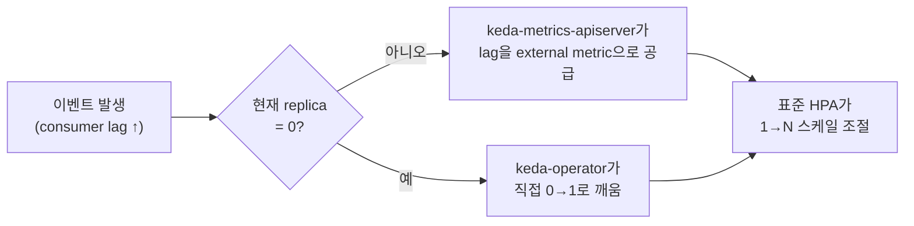

# Kafka 파티션·컨슈머 스케일링 전략

> 최종 업데이트: 2026-08-25 | Apache Kafka + KEDA 기준

## 개념

"파티션을 몇 개로 할까"와 "컨슈머를 몇 개로 할까"는 **서로 다른 성격의 결정**인데도 자주 하나로 뭉뚱그려진다. **파티션 수**는 토픽 설계 시점에 정하는 **상한선**이고, **컨슈머 수**는 그 상한 안에서 운영 중 계속 조절하는 **운영 변수**다. 이 둘을 같은 전략으로 접근하면 한쪽이 항상 어긋난다.

> 도로에 비유하면 — **파티션 수는 차선 수**다. 공사(파티션 증설)해야 바뀌고, 공사 중엔 기존 차량(key 기반 순서)의 차선 배정이 흐트러진다. **컨슈머 수는 그 도로를 달리는 차량 수**다. 교통량(트래픽)에 맞춰 매일, 매시간 바뀌어도 아무 문제가 없다. 차선 공사를 자주 할 수 없으니 미래 교통량을 감안해 넉넉히 깔아두지만, 차량 수까지 차선 수만큼 고정해 항상 채워 넣을 필요는 없다.

## 파티션 수 — 미리 넉넉히, 그러나 무한정은 아니다

파티션 수를 정하는 원칙은 **"지금 컨슈머 수"가 아니라 "1~2년 후 목표 처리량"**이다. 파티션은 운영 중 늘리기가 사실상 어렵다 — 늘리면 key 기반 해싱이 재계산돼 **같은 key가 다른 파티션으로 옮겨가며 순서 보장이 깨진다.** 그래서 처음부터 여유 있게 잡아두는 **오버파티셔닝**이 정석이다.

단 무한정 늘려도 되는 건 아니다. 파티션 하나하나가 파일 핸들·메모리·복제 트래픽·컨트롤러 메타데이터를 먹고, 브로커 장애 시 복구 시간까지 늘린다. 이 비용 구조와 브로커당/클러스터당 경험칙은 → [Kafka-Topic.md의 "파티션은 비용 단위" 섹션](Kafka-Topic.md#파티션은-비용-단위--무작정-늘리면-안-되는-이유)에서 이미 다룬다. 요지만 다시 적으면: **오버파티셔닝은 "무한정 여유"가 아니라 "합리적으로 예측된 미래치 + 마진"**이어야 한다 — 그 마진의 상한을 넘으면 비용이 상시로 발생한다.

## 컨슈머 수 — "일치"와 "유휴 없음"은 다른 이야기

**컨슈머 수를 파티션 수에 정확히 맞추면, Kafka 프로토콜 관점에서 파티션을 못 받는 컨슈머는 없다.** 이건 맞는 말이다. 하지만 "유휴(idle)"의 정의를 넓혀 보면 이야기가 달라진다.

| 관점 | "유휴"의 기준 | 정확히 일치시켰을 때 |
|------|--------------|----------------------|
| **Kafka 프로토콜** | 파티션을 배정 못 받음 | 없음 — 전부 파티션 1개씩 배정됨 |
| **리소스 활용** | 실제 처리할 메시지가 컨슈머 용량보다 훨씬 적음 | 트래픽 낮은 시간엔 "배정은 받았지만 할 일 없는" 상태 — 여전히 CPU·메모리를 예약 중 |

즉 "유휴 컨슈머가 없다"가 **"낭비가 없다"를 뜻하지는 않는다.** 파티션 수만큼 컨슈머를 상시 고정해두면, **트래픽이 가장 낮은 시간에도 가장 높은 시간 기준의 용량을 계속 켜둬야** 한다.

여기에 두 가지 비용이 더 붙는다.

- **리밸런싱 비용은 그룹 크기에 비례한다** — 파티션 20개에 컨슈머 20개를 고정해두면, **그중 하나만 재배포·재시작해도 리밸런싱은 그룹 전체(20개) 기준**으로 일어난다. 그룹을 필요 이상으로 크게 유지할수록 배포마다 이 비용을 매번 더 낸다. (→ [Kafka-Consumer.md의 리밸런싱 섹션](Kafka-Consumer.md#리밸런싱과-파티션-할당-전략))
- **진짜 상한이 다른 곳에 있을 수 있다** — 컨슈머를 파티션 수만큼 늘려도, 각 스레드가 결국 DB나 외부 API를 호출한다면 실제 처리량은 그쪽 한도(예: [DB 커넥션 풀](../Database/데이터베이스-이론/DB-커넥션.md) 크기)에서 막힌다. Kafka 쪽만 최대로 맞춰봤자 다운스트림에서 대기가 늘어날 수 있다.

## 정적 배치 vs 동적 스케일링

| | 정적 배치 (`replicas: N` 고정) | 동적 스케일링 (오토스케일러) |
|---|-------------------------------|-------------------------------|
| 적합한 경우 | 트래픽이 하루 종일 **거의 일정** | 트래픽에 **일/주/계절 변동**이 있음 |
| 장점 | 단순, 예측 가능 | 트래픽 낮을 때 비용 절감, 높을 때 자동 대응 |
| 단점 | 트래픽 변화 시 한쪽으로 항상 어긋남(과잉 or 부족) | 스케일 트리거·범위 설정이 추가로 필요 |

실무의 Kafka 컨슈머 트래픽은 거의 항상 변동이 있으므로(낮/밤, 배포 직후 재처리, 이벤트성 폭주 등), **정적 배치보다 동적 스케일링이 기본값**에 가깝다.

## KEDA — 이벤트 기반 오토스케일러

**KEDA(Kubernetes Event-Driven Autoscaling)** 는 Microsoft와 Red Hat이 2019년 공동 개발한 오픈소스로, 2020년 3월 CNCF에 기증돼 2021년 8월 Incubating, **2023년 8월 Graduated**(CNCF 최고 성숙도) 등급을 받았다.

### 왜 필요한가

K8s 기본 오토스케일러 **HPA(Horizontal Pod Autoscaler)**는 CPU·메모리 사용률만 본다. Kafka consumer lag이 쌓여도 컨슈머는 그냥 대기 상태라 CPU가 안 오를 수 있어, HPA만으로는 "메시지가 밀렸다"는 신호를 못 본다. KEDA는 HPA를 대체하지 않고, **lag 같은 이벤트 신호를 HPA가 이해할 수 있는 지표로 번역해 공급**하는 역할을 한다.

### 구조 — CRD + Operator

`ScaledObject`라는 CRD로 "이 Deployment를 이 이벤트 기준으로 스케일하라"를 선언한다. [CRD와 Operator 패턴](../DevOps/kubernetes/CRD와-Operator-패턴.md)과 정확히 같은 구조다 — `ScaledObject`(CR)를 `keda-operator`(Controller)가 감시하며 실제 replica 수를 맞춘다.

```yaml
apiVersion: keda.sh/v1alpha1
kind: ScaledObject
metadata:
  name: kafka-consumer-scaler
spec:
  scaleTargetRef:
    name: my-consumer-deployment
  minReplicaCount: 1        # 항상 최소 1개는 유지(콜드스타트 회피)
  maxReplicaCount: 20       # 보통 파티션 수를 상한으로
  triggers:
    - type: kafka
      metadata:
        lagThreshold: "10"  # lag이 이 값을 넘으면 스케일업
```

### 동작 — 두 구간이 다른 주체가 처리



- **0 → 1**: HPA는 replica 0에서는 지표를 못 읽으므로 다루지 못한다. **KEDA operator가 직접** Deployment를 깨운다.
- **1 → N**: 이후는 **표준 K8s HPA에 위임**한다. `replicas` 필드를 실제로 patch하는 건 K8s의 기존 HPA 메커니즘 그대로다 — KEDA는 "무엇을 신호로 볼지"만 확장한다.

### `minReplicaCount`는 0이 아니어도 된다

**"최소 1 이상 유지"가 KEDA를 못 쓰는 이유는 아니다.** `minReplicaCount: 1`로 두면 콜드스타트(0에서 깨우는 지연)를 없애면서, 1→N 구간의 lag 기반 오토스케일링은 그대로 동작한다. 이벤트를 놓치면 안 되거나 즉시 반응이 필요한 리스너는 오히려 이 설정을 표준으로 쓴다.

## 종합 — 언제 어떻게 정하나

| 결정 항목 | 기준 | 재조정 난이도 |
|-----------|------|---------------|
| **파티션 수** | 1~2년 후 목표 처리량(오버파티셔닝) | 어려움 — key 순서 보장이 깨짐 |
| **컨슈머 `maxReplicaCount`** | 파티션 수(그 이상은 의미 없음) | 파티션 수 변경 시에만 |
| **컨슈머 `minReplicaCount`** | 콜드스타트 허용 여부 — 허용되면 0, 즉시 반응 필요하면 1 이상 | 언제든 쉬움 |
| **스케일 트리거** | consumer lag 기준(`lagThreshold`) | 언제든 쉬움 |

파티션 수는 **신중하게, 여유 있게, 한 번** 정하고, 그 상한 안에서 컨슈머 수는 **KEDA로 트래픽에 맞춰 계속 조절**하는 것이 두 결정을 각자의 성격에 맞게 다루는 방식이다.

## 정리

> **파티션 수와 컨슈머 수는 다른 종류의 결정이다.** 파티션 수는 재조정이 어려우니 미래 목표 처리량 기준으로 여유 있게(그러나 무한정은 아니게) 미리 정하고, 컨슈머 수는 그 상한 안에서 트래픽에 맞춰 계속 조절하는 운영 변수로 다룬다. 컨슈머를 파티션 수에 정확히 맞추면 Kafka 프로토콜상 유휴는 없지만, 트래픽이 낮을 때도 피크 용량을 상시 유지하는 비용·큰 그룹의 리밸런싱 비용·다운스트림 병목은 여전히 남는다. **KEDA**는 HPA에 consumer lag 같은 이벤트 신호를 공급해 이 컨슈머 수 조절을 자동화하며, `minReplicaCount`로 최소 유지 개수를 지정할 수 있어 "최소 1 이상 유지"와도 양립한다.

## 관련 문서

- [Kafka-Topic.md](Kafka-Topic.md) — 파티션 비용 구조와 브로커/클러스터 경험칙
- [Kafka-Consumer.md](Kafka-Consumer.md) — 컨슈머 그룹의 파티션 배정, 리밸런싱, lag
- [DB-커넥션](../Database/데이터베이스-이론/DB-커넥션.md) — 컨슈머 확장을 막는 다운스트림 병목의 예
- [CRD와 Operator 패턴](../DevOps/kubernetes/CRD와-Operator-패턴.md) — KEDA `ScaledObject`가 따르는 구조
- [선언형 vs 명령형](../CS-이론/선언형-vs-명령형.md) — KEDA reconciliation loop의 원리

## 출처

- [Confluent — How to Choose the Number of Topics/Partitions in a Kafka Cluster](https://www.confluent.io/blog/how-choose-number-topics-partitions-kafka-cluster/)
- [KEDA Documentation — Concepts](https://keda.sh/docs/latest/concepts/)
- [KEDA Documentation — Apache Kafka Scaler](https://keda.sh/docs/latest/scalers/apache-kafka/)
- [CNCF — KEDA Project Page](https://www.cncf.io/projects/keda/)
